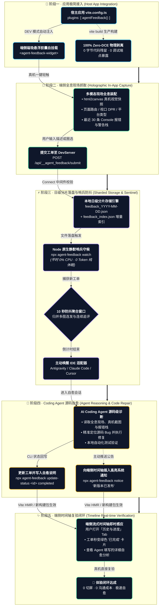

# Agent Feedback Bridge (@lylyuanliang/agent-feedback-*)

> **The In-App Nervous System & Live Loop for AI Coding Agents**<br>
> 面向 AI Coding Agent 时代的端侧神经系统、自愈闭环桥梁与可扩展开发者浮动工作台

[](LICENSE)
[](https://www.npmjs.com/package/@lylyuanliang/agent-feedback-vite-plugin)
[](#)
[](#)
[](#)

---

## 🌟 为什么需要 Agent Feedback Bridge？

在 AI Coding Agent（Antigravity、Cursor、Claude Code 等）时代，开发者与 AI 结对编程的痛点依然存在于**“运行时感知与真机还原”**：
- 在手机真机、移动端 Web 或桌面端测试时发现 Bug，传统方式需要切出应用、手工截屏、打开 IDE 聊天框打字描述；
- 现场报错、控制台异常、网络状态、DOM 快照与精确视口难以一并提供给 AI；
- 传统 APM/反馈工具（Sentry、Marker.io）是将工单发给人（Jira/Slack），而我们需要的是**直接唤醒本地 IDE 中的 Coding Agent 自行分析并热修复**。

**Agent Feedback Bridge 提供的革命性自愈闭环**：
```
[真机/端侧一键点击] ──(截图+路由+报错全息打包)──> [本地 DevServer 日级分片队列]
                                                          │
                                                    (10s 防抖聚合)
                                                          │
                                                          ▼
[端侧时间轴实时同步修复进展] <──(CLI/状态回写)── [唤醒 IDE 中的 Coding Agent 自愈闭环]
```

---

## 🏆 核心优势 (Core Advantages)

不同于传统的简单反馈组件或单向文本日志收集器，**Agent Feedback Bridge** 是一套专为**人机结对开发、移动真机全息感知与本地 AI 闭环自愈**而生的全栈神经系统：

1. 📱 **移动真机全场景工程化 (Mobile-First Touch & Native Experience)**
   - **深度适配真实移动端**：专攻手机真机、原生容器（Capacitor / Cordova / React Native WebView）与移动 Web，绝非简陋的桌面网页工具；
   - **工业级手势工程**：全贴边磁吸阻尼停靠、Pointer Events 级触控消抖（防误触误拖拽）、450ms 穿透门禁（彻底解决遮罩空白区伴随合成点击导致的误关闭）以及软键盘弹出防挤压与视口自适应。

2. 🛰️ **端侧全息遥测与高保真真实视觉 (Holographic Telemetry & Real-DOM Capture)**
   - **0 沟通成本现场装配**：一键自动捕获屏幕 DPR、真实视口尺寸、操作系统平台架构、页面 Hash 路由、以及最近 30 条 Console 报错与警告栈；
   - **高保真轻量真实截屏**：采用 `html2canvas` 自动捕获当前界面的真实全屏视觉画面，智能 Canvas 压缩算法将原图压缩 99% 至 ~80KB 轻量高保真 JPEG，秒级通过局域网/穿透网络上传；同时支持手机相册上传最多 6 张实景照片，并提供全屏手势 Lightbox 大图预览。

3. 🔄 **真正的端到端双向自愈闭环 (Bi-directional Self-Healing Neural Loop)**
   - **打破“只报不修”的死胡同**：端侧手机提交 -> DevServer 日级分片落盘 -> 静默哨兵（0% CPU，0 Token 消耗）守候并开启 10 秒防抖聚合 -> 主动唤醒 IDE 本地 Coding Agent -> Agent 源码级诊断、精准修复并通过自动化测试 -> CLI 状态回写；
   - **端侧无感进度复验**：端侧「历史与进度」时间轴内置 5 秒轻量自动轮询，工单修复后秒级变绿并直接展示 Agent 填写的详细自愈分析报告；支持 Agent / 流水线向端侧主动下发系统广播通知。

4. 🔌 **开放扩展槽架构 (Extension Tabs Workbench)**
   - **单一胶囊，无限扩展**：手机屏幕上仅需一个优雅悬浮胶囊，宿主应用通过 `registerExtensionTab` 规范即可无缝挂载专属业务能力（例如：内网穿透通信诊断、APK 流式断点续传在线更新、切屏保活等）；
   - **100% 生产零残留 (Zero-DCE)**：生产构建（`vite build`）全量物理剥离，构建产物增加 0 字节，0 调试接口泄露，完全不影响生产性能与安全。

---

## 🔄 端到端自愈工作闭环流程 (End-to-End Self-Healing Workflow)

Agent Feedback Bridge 不仅是一个前端悬浮组件，而是一套连接**移动真机端侧运行现场**与**开发机本地 AI Coding Agent** 的完整自动化闭环神经系统。整个生命周期涵盖 5 大阶段：



### 闭环流程各阶段职责详解

1. **第 1 阶段：应用极简接入 (Host App Integration)**
   - **0 业务侵入**：开发者仅需在宿主应用的 `vite.config.ts` 中注册 `agentFeedback()` 插件，无需修改任何业务页面或组件代码；
   - **自动化挂载**：在开发模式下，插件会自动将 `@lylyuanliang/agent-feedback-client` 注入到 HTML 入口中，自挂载 `<agent-feedback-widget>` 悬浮胶囊；
   - **生产零污染 (Zero-DCE)**：执行正式打包（`vite build`）时，插件内部配置了 Rollup 虚拟外部化策略，所有组件代码与调试接口 100% 物理消除，生产产物增加 0 字节。

2. **第 2 阶段：端侧全息现场抓取 (Holographic In-App Capture)**
   - **现场视觉还原**：用户在手机真机或 Web 端点击悬浮胶囊呼出模态框时，组件自动调用 `html2canvas` 捕获当前屏幕的高保真图像（支持长图/高清 DPR 自适应）；
   - **全息元数据自动装配**：自动提取端侧当前页面路由（Hash/History Path）、设备视口尺寸、屏幕像素比（DPR）、网络类型及最近 20 条 Console 报错与警告栈，彻底告别“截屏后手动描述环境”的低效沟通。

3. **第 3 阶段：日级分片落盘与哨兵防抖唤醒 (Sharded Storage & Sentinel Debounce)**
   - **项目内同源存储**：工单提交至宿主 DevServer 的内置中间件，中间件校验安全防注入规则后，按日期归档至本地 `scratch/feedback/feedback_YYYY-MM-DD.json` 并维护增量索引；
   - **0 Token 哨兵守候**：后台守护进程（`npx agent-feedback watch`）平时处于纯休眠状态，不调用大模型 API，0% 资源开销；
   - **10 秒防抖聚合**：检测到第 1 条新反馈后，自动开启 10 秒倒计时聚合窗口，将测试人员连续连发的数张补充截图与追评聚合成同一结构化工单，窗口结束后触发通知主动唤醒 IDE 中的 Coding Agent。

4. **第 4 阶段：Coding Agent 源码自愈与状态回写 (Agent Reasoning & Code Repair)**
   - **上下文深度感知**：本地被唤醒的 Coding Agent（如 Antigravity、Claude Code、Cursor 等）直接从分片文件中读取工单，结合精准的文件源码与报错堆栈，自主推理根因并进行代码热修复；
   - **测试驱动交付**：Agent 修改代码后运行本地测试，确认修复无误后，通过哨兵 CLI 命令行：
     ```bash
     npx agent-feedback update-status 1793175462520 completed "已重构事件监听逻辑，修复了移动端手势冲突问题。"
     ```
     将工单状态置为 `completed` 并写入技术自愈说明。

5. **第 5 阶段：端侧时间轴复验与体验闭环 (Timeline Real-time Verification)**
   - **双向流式透传**：端侧用户无需重启应用，只需在悬浮窗中切换至「历史与进度」Tab，即可在时间轴上看到自己刚才提交的工单已变为绿色“已解决”卡片，并能直接阅读 AI Agent 回写的修改详情；
   - **系统级主动通知**：除工单自愈外，Agent 或 CI 流水线还可通过 `npx agent-feedback notice "新包已推送到内测通道"` 主动向时间轴插入高亮系统公告，实现从“端侧上报”到“AI 修复”再到“端侧回传”的完整生命周期。

> 💡 **多 Agent 生态兼容说明**：
> 哨兵绝不仅支持 Antigravity，而是内置了**响应式退出、Headless CLI 命令调起、标准 Stdio MCP 服务与 Webhook HTTP 投递** 4 大可插拔适配器，全面兼容 **Claude Code**、**OpenAI Codex**、**DeepSeek / DSH**、**ZCode 内部自研智能体** 以及 **Cursor / Windsurf**！
> 👉 详细实施与配置参见：[**智能体生态接入与多 Agent 闭环指南 (docs/multi-agent-integration-guide.md)**](docs/multi-agent-integration-guide.md)

---

## ✨ 核心特性

- 🚀 **0 侵入一行接入 (Zero-Code DX)**：只需在 `vite.config.ts` 加入插件，业务代码无需修改即可自动在页面挂载磁吸胶囊。
- 🛡️ **0 样式污染 (Shadow DOM Isolation)**：端侧悬浮窗完全运行在独立 Open Shadow Root 中，与业务 CSS 100% 隔离。
- 🎨 **三层 Theme Token 主题系统**：
  - 内置 `dark`（暗黑极客）、`light`（清爽浅色）与 `auto`（自适应系统/宿主暗黑类名）预设；
  - CSS 自定义属性（`--af-primary`、`--af-bg-base`、`--af-bg-surface` 等）天然穿透 Shadow DOM，1 行 CSS 即可统一全组件品牌色。
- 🔌 **扩展槽插件体系 (Extension Tabs API)**：
  - 不仅是反馈工具，更是通用的开发者浮动工作台！
  - 宿主项目可通过 `registerExtensionTab` 自由注册自定义 Tab（例如：内测在线更新、Mock 控制台、通信穿透诊断等）。
- 📅 **日级分片存储架构 (Daily Sharded Queue)**：
  - 工单按天归档为 `feedback_YYYY-MM-DD.json` + `feedback_index.json`，彻底告别单文件膨胀与读写冲突，海量历史毫秒级加载。
- ⏱️ **流式时间轴与双向通知 (Timeline UI)**：
  - 首屏秒开最新一天工单，支持向上流式触底加载历史记录；
  - 独立支持 `[🤖 Agent 系统通知]`（高光青绿卡片）与 `[👤 用户反馈]`，支持流水线或 Agent 主动向端侧推送通知。
- 💤 **0 Token 静默休眠与秒级唤醒**：无反馈时保持休眠（0% CPU 占用、0 大模型 Token 消耗）；捕获新反馈后开启 10 秒防抖聚合，并通过适配器主动唤醒 IDE 中的 AI 会话。
- 🌐 **0 生产残留 (100% Zero-DCE)**：生产构建（`vite build`）全量物理剥离，构建产物增加 0 字节，0 调试接口泄露。

---

## 📦 Monorepo 子包生态矩阵

| 包名 | 最新版本 | 职责与能力 | 推荐安装命令 |
| :--- | :--- | :--- | :--- |
| [`@lylyuanliang/agent-feedback-vite-plugin`](packages/vite-plugin) | [](https://www.npmjs.com/package/@lylyuanliang/agent-feedback-vite-plugin) | **核心推荐**：Vite 构建插件、日级分片落盘引擎、DevServer 中间件与生产 Zero-DCE 剥离 | `pnpm add -D @lylyuanliang/agent-feedback-vite-plugin` |
| [`@lylyuanliang/agent-feedback-client`](packages/client) | [](https://www.npmjs.com/package/@lylyuanliang/agent-feedback-client) | `<agent-feedback-widget>` Web Component、手势工程、流式时间轴、多面板 KeepAlive 与扩展槽挂载器 | `pnpm add @lylyuanliang/agent-feedback-client` |
| [`@lylyuanliang/agent-feedback-sentinel`](packages/sentinel) | [](https://www.npmjs.com/package/@lylyuanliang/agent-feedback-sentinel) | Node 原生静默哨兵 CLI、10s 防抖聚合与多 IDE（Antigravity/Cursor/Claude Code）自愈适配器 | `npx agent-feedback watch` (免安装) 或 `pnpm add -D @lylyuanliang/agent-feedback-sentinel` |
| [`@lylyuanliang/agent-feedback-core`](packages/core) | [](https://www.npmjs.com/package/@lylyuanliang/agent-feedback-core) | 底层标准契约（TypeScript Types）、日级索引接口、扩展槽规范与启发式注入/破坏指令防御 | `pnpm add @lylyuanliang/agent-feedback-core` |

---

## 🚀 快速上手 (Quick Start)

### 1. 安装依赖

根据你的项目技术栈与包管理器，执行对应的安装命令：

#### 方案 A：Vite 零侵入极简接入（最常用 · 推荐）
只需安装开发依赖插件，开发期自动注入磁吸胶囊，生产构建（`vite build`）全量物理剥离（Zero-DCE）：

```bash
# npm
npm install -D @lylyuanliang/agent-feedback-vite-plugin

# pnpm
pnpm add -D @lylyuanliang/agent-feedback-vite-plugin

# yarn
yarn add -D @lylyuanliang/agent-feedback-vite-plugin

# bun
bun add -d @lylyuanliang/agent-feedback-vite-plugin
```

#### 方案 B：需要编写自定义扩展 Tab 或 TypeScript 类型定义
若需要调用 `registerExtensionTab` 挂载业务面板（如在线升级、设备诊断）或编程式控制弹窗：

```bash
# npm
npm install -D @lylyuanliang/agent-feedback-vite-plugin
npm install @lylyuanliang/agent-feedback-client

# pnpm
pnpm add -D @lylyuanliang/agent-feedback-vite-plugin
pnpm add @lylyuanliang/agent-feedback-client
```

#### 方案 C：固化静默哨兵 CLI 命令至工程
若希望在项目内固化 `npm run sentinel` 脚本，可将哨兵包作为开发依赖安装：

```bash
# npm
npm install -D @lylyuanliang/agent-feedback-sentinel

# pnpm
pnpm add -D @lylyuanliang/agent-feedback-sentinel
```

> **免安装运行提示**：也可以无需安装哨兵包，直接运行 `npx agent-feedback watch` 或 `pnpm dlx @lylyuanliang/agent-feedback-sentinel watch` 即用即启！

### 2. 在 Vite 中启用

```typescript
// vite.config.ts
import { defineConfig } from 'vite'
import vue from '@vitejs/plugin-vue' // 或 react()
import agentFeedback from '@lylyuanliang/agent-feedback-vite-plugin'

export default defineConfig({
  plugins: [
    vue(),
    agentFeedback({
      storageDir: 'scratch/feedback', // 工单日级分片本地存储目录 (默认: .agent/feedback)
      theme: 'dark',                  // 主题模式: 'dark' | 'light' | 'auto' (默认: 'dark')
      primaryColor: '#4edea3',        // 自定义核心主色 (可选)
      tunnel: false                   // 是否自动开启临时 HTTPS 穿透 (默认: false)
    })
  ]
})
```

### 3. 启动开发服务与哨兵

```bash
# 终端 1：启动应用 (此时页面已自动出现磁吸悬浮胶囊)
npm run dev

# 终端 2：启动 AI 哨兵守候 (当收到端侧反馈时自动防抖并唤醒 IDE 中的 Agent)
npx agent-feedback watch --dir scratch/feedback
```

---

## 🌐 真机联调与网络互通指南 (Mobile Device & Networking Guide)

Agent Feedback Bridge 的核心理念是让 AI Coding Agent 能够直接感知**移动端真机运行现场**。由于 AI Agent 运行在开发者的电脑 IDE 中，端侧（手机/平板/外部设备）必须能够访问到开发机的 DevServer 接口。

### 1. 默认服务机制 (0 独立后端，同源内置)

- `@lylyuanliang/agent-feedback-vite-plugin` 采用标准 Connect 中间件机制，**直接无缝挂载在宿主项目自身的 Vite DevServer 实例上**（无需额外启动独立后端服务、数据库或占用额外端口）；
- 默认情况下，端侧客户端（`<agent-feedback-widget>`）发出的所有工单请求均采用**同源相对路径**（`/api/__agent_feedback/*`），默认自然请求到**当前项目自己的服务地址**。

### 2. 多端测试网络拓扑矩阵

| 测试场景 | 端侧访问地址 | DevServer 网络配置 | `apiBase` 配置需求 |
| :--- | :--- | :--- | :--- |
| **A. 本地电脑桌面浏览器** | `http://localhost:5173` | 默认 `localhost` 即可 | **无需配置**（自动同源请求） |
| **B. 同一局域网 Wi-Fi 真机测试** | `http://192.168.x.x:5173` | 配置 `server: { host: true }` | **无需配置**（手机打开局域网网页，自动同源请求） |
| **C. 远程外网 / 4G / 5G 移动流量公测** | `https://xxxx.cpolar.top` | 使用 cpolar / ngrok 内网穿透 | **无需配置**（手机通过穿透域名访问网页，自动同源） |
| **D. 移动端混合原生 App (Capacitor/Cordova/Tauri)** | `capacitor://localhost` (离线内置包) | 开发机启动穿透或局域网服务 | **必须显式配置 `apiBase`**（指向开发机穿透地址） |

### 3. 外网穿透暴露服务 (以 cpolar / ngrok 为例)

当测试人员在室外走测，或手机使用移动蜂窝流量（4G/5G）不在同一 Wi-Fi 下时，可通过内网穿透工具将本机的 Vite DevServer 暴露至公网：

```bash
# 方式 1: 使用 cpolar (国内极速)
cpolar http 5173
# 输出: Forwarding -> https://7a3bxxxx.cpolar.top -> http://localhost:5173

# 方式 2: 使用 ngrok
ngrok http 5173

# 方式 3: 使用 Cloudflare Tunnel (免费免客户端)
cloudflared tunnel --url http://localhost:5173
```

将穿透生成的 HTTPS 公网域名（如 `https://7a3bxxxx.cpolar.top`）发送给手机打开，即可直接在真机上体验一键截屏反馈与 AI 哨兵自愈闭环！

### 4. 移动原生 App / 离线包指定 `apiBase` 姿势

在 Capacitor、Cordova、React Native WebView 或 Tauri 等混合原生应用中，Webview 页面加载自手机本地离线资产目录（如 `http://localhost` 或 `capacitor://localhost`），相对路径无法触达电脑端。此时可通过以下 3 种方式之一注入外部基地址：

#### 方式 A: 在 `vite.config.ts` 插件中配置 (推荐)
```typescript
agentFeedback({
  storageDir: 'scratch/feedback',
  apiBase: 'https://7a3bxxxx.cpolar.top' // 声明远程开发机穿透地址
})
```

#### 方式 B: 运行时代码动态配置 (支持环境切换或用户配置面板)
```typescript
import { setApiBase } from '@lylyuanliang/agent-feedback-client';

// 当检测到原生容器或用户在调试设置中输入穿透地址时动态切换
if (window.Capacitor?.isNativePlatform()) {
  setApiBase('https://7a3bxxxx.cpolar.top');
}
```

#### 方式 C: 挂载时通过 HTML 自定义标签属性声明
```html
<agent-feedback-widget api-base="https://7a3bxxxx.cpolar.top"></agent-feedback-widget>
```

---

## 🔌 扩展槽功能指南 (Extension Tabs API)

`@lylyuanliang/agent-feedback-client` 提供了灵活的扩展槽机制，允许宿主应用在同一个悬浮胶囊中挂载专属的开发者功能页签（如环境切换、离线包更新、通信诊断等），使移动端调试体验高度聚合，无需在界面上摆放多个悬浮按钮。

### 注册自定义扩展 Tab 示例

```typescript
import { registerExtensionTab } from '@lylyuanliang/agent-feedback-client'
import { createApp } from 'vue' // 支持 Vue / React / 原生 HTML
import MyCustomDebugPanel from './components/MyCustomDebugPanel.vue'

// 在应用入口 (如 main.ts) 中注册
if (import.meta.env.DEV) {
  registerExtensionTab({
    id: 'my-custom-tools',            // 唯一 ID
    label: '🛠️ 联调与工具',             // Tab 显示文本 (支持 Emoji 或图标)
    render(container, context) {
      // 方式 A: 挂载 Vue 组件
      const app = createApp(MyCustomDebugPanel, {
        onClose: context.closeModal,
        onSwitchTab: context.openTab
      })
      app.mount(container)

      // 返回清理回调 (切走 Tab 或销毁时触发)
      return () => {
        app.unmount()
      }

      /* 方式 B: 原生 DOM 渲染
      container.innerHTML = `
        <div style="padding: 16px; color: var(--af-text-main);">
          <h3>自定义开发面板</h3>
          <button id="btn-action" style="background: var(--af-primary);">执行动作</button>
        </div>
      `
      */
    }
  })
}
```

> **提示 (Shadow DOM 样式隔离注意项)**：
> 由于扩展内容挂载在 Web Component 的 Shadow DOM 内部，宿主页面的全局外部 CSS（如 Tailwind 全局原子类）默认不会穿透进去。
> 建议在自定义扩展组件内使用内嵌样式或 Scoped CSS，并优先复用组件库提供的 `--af-*` 语义化设计 Token。

---

## 🎨 主题与样式定制 (Theme Token System)

组件内部使用 CSS Custom Properties 组织样式，完全支持穿透 Shadow DOM 进行品牌定制：

```css
/* 在宿主项目的任意全局 CSS 文件中 */
:root {
  --af-primary: #2563eb;       /* 核心主色：胶囊边框、按钮、高亮焦点 */
  --af-bg-base: #ffffff;       /* 底层背景：模态框底层、输入框背景 */
  --af-bg-surface: #f8fafc;    /* 卡片表面：工单卡片、选项容器 */
  --af-text-main: #0f172a;     /* 一级文本颜色 */
  --af-text-muted: #64748b;    /* 次级文本颜色、时间戳 */
  --af-border: rgba(0,0,0,0.08); /* 边框与分割线颜色 */
  --af-radius: 12px;           /* 核心容器圆角 */
}
```

---

## 🛠️ CLI 命令行工具链

`@lylyuanliang/agent-feedback-sentinel` 提供了便捷的命令行能力：

```bash
# 1. 启动静默监听哨兵
npx agent-feedback watch --dir scratch/feedback --adapter antigravity

# 2. 向端侧时间轴主动插入一条 Agent 系统通知 (支持 CI/CD 或任务完成后自动调用)
npx agent-feedback notice "🎉 新版本已部署，修复了详情页图片偶发白屏问题，请在手机端复验。" --dir scratch/feedback

# 3. 更新工单状态并写入自愈说明 (闭环通知端侧)
npx agent-feedback update-status <feedback-id> completed "经排查问题已修复并在当前版本生效，请在端侧下拉刷新验证。" --dir scratch/feedback
```

---

## 📱 完整工业级参考项目 (Reference Implementation)

本项目已在开源户外拓扑应用 **《每周一山 · 成都周边50座山》** 中完成端到端全链路落地与实战检验：

- 🔗 **参考工程 GitHub 仓库**：[lylyuanliang/weekly-mountain](https://github.com/lylyuanliang/weekly-mountain)
- 🌿 **完整接入代码分支**：[`feat/integrate-agent-feedback`](https://github.com/lylyuanliang/weekly-mountain/tree/feat/integrate-agent-feedback)

### 架构落地与最佳实践亮点

1. **职责正交解耦 (Clean Separation of Concerns)**：
   在宿主工程的 [`vite.config.js`](https://github.com/lylyuanliang/weekly-mountain/blob/feat/integrate-agent-feedback/vite.config.js) 中，业务专属的构建逻辑与服务（如业务发布下载、离线包、特定 API Mock 等）保持在独立的轻量插件中，而将所有的真机现场抓取、日级分片落盘与哨兵唤醒彻底委托给 `agentFeedback()` 插件，实现极高内聚与清晰解耦。
2. **统一开发者入口与扩展槽 (Unified Developer Hub via Extension Tabs)**：
   通过 [`src/debug/setupAgentFeedback.js`](https://github.com/lylyuanliang/weekly-mountain/blob/feat/integrate-agent-feedback/src/debug/setupAgentFeedback.js) 调用 `registerExtensionTab`，将应用专属的内测在线更新、下载进度展示、WakeLock 切屏防中断以及局域网穿透诊断等能力无缝注入为同一个悬浮模态框的自定义 Tab（`🛠️ 联调与更新`），手机屏幕上只有一个悬浮胶囊即可纵览全部开发者能力，彻底避免多悬浮球相互遮挡。
3. **沉浸式主题系统融合 (Design System Integration)**：
   展示了在强风格化的暗黑拓扑应用中，如何仅通过配置主题模式（`theme: 'dark'`、`primaryColor: '#4edea3'`）并声明基础 CSS Token，使悬浮组件与宿主既有的黑曜石半透明高山设计系统融为一体，保持专业一致的视觉体验。

---

## 📄 开源许可证

本项目采用 [MIT 许可证](LICENSE)。
