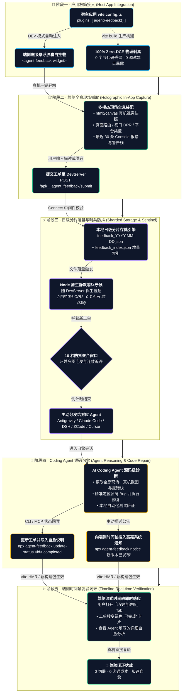
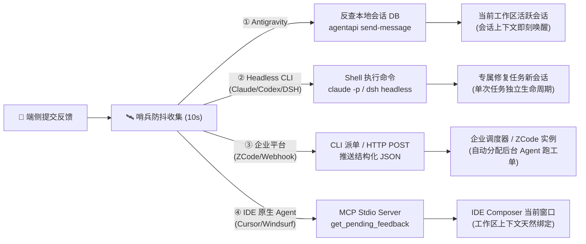

# Agent Feedback Bridge (@lylyuanliang/agent-feedback-*)

> **The In-App Nervous System & Live Loop for AI Coding Agents**<br>
> 面向 AI Coding Agent 时代的端侧神经系统、自愈闭环桥梁与可扩展开发者浮动工作台

[](LICENSE)
[](https://www.npmjs.com/package/@lylyuanliang/agent-feedback-vite-plugin)
[](#)
[](#)
[](#)

> 📖 **官方多智能体接入生态指南**：针对不同智能体的能力准入矩阵、会话路由底层原理与企业级派单拓扑，请参阅专题文档：[**《智能体生态接入与多 Agent 闭环指南》**](docs/multi-agent-integration-guide.md)

---

## 🌟 为什么需要 Agent Feedback Bridge？

在 AI Coding Agent（Antigravity、Cursor、Claude Code、Codex、DSH、ZCode 等）时代，开发者与 AI 结对编程的痛点依然存在于**“运行时感知与真机还原”**：
- **现场还原成本高**：在手机真机、移动端 Web 或桌面端测试时发现 Bug，传统方式需要切出应用、手工截屏、打开 IDE 聊天框打字描述环境；
- **遥测数据碎片化**：现场报错堆栈、控制台异常、网络状态、DOM 快照与精确视口难以一并提供给 AI；
- **传统工具无法闭环**：传统 APM/反馈工具（Sentry、Marker.io）是将工单发给人（Jira/Slack），而我们需要的是**直接唤醒本地 IDE 中的 Coding Agent 自行分析并热修复**。

**Agent Feedback Bridge 提供的革命性自愈闭环**：
```
[真机/端侧一键点击] ──(截图+路由+报错全息打包)──> [本地 DevServer 日级分片队列]
                                                          │
                                                    (10s 防抖聚合)
                                                          │
                                                          ▼
[端侧时间轴实时同步修复进展] <──(CLI/状态回写)── [唤醒 IDE 中的 Coding Agent 自愈闭环]
```

---

## 🏆 四大核心优势 (Core Advantages)

不同于传统的简单反馈组件或单向文本日志收集器，**Agent Feedback Bridge** 是一套专为**人机结对开发、移动真机全息感知与本地 AI 闭环自愈**而生的全栈神经系统：

1. 📱 **移动真机全场景工程化 (Mobile-First Touch & Native Experience)**
   - **深度适配真实移动端**：专攻手机真机、原生容器（Capacitor / Cordova / React Native WebView）与移动 Web，绝非简陋的桌面网页工具；
   - **原生触控手势工程**：全贴边磁吸阻尼停靠、Pointer Events 级触控消抖（防误触误拖拽）、450ms 穿透门禁（彻底解决遮罩空白区伴随合成点击导致的误关闭）以及软键盘弹出防挤压与视口自适应。

2. 🛰️ **端侧全息遥测与高保真真实视觉 (Holographic Telemetry & Real-DOM Capture)**
   - **0 沟通成本现场装配**：一键自动捕获屏幕 DPR、真实视口尺寸、操作系统平台架构、页面 Hash 路由、以及最近 30 条 Console 报错与警告栈；
   - **高保真轻量真实截屏**：采用 `html2canvas` 自动捕获当前界面的真实全屏视觉画面，智能 Canvas 压缩算法将原图压缩 99% 至 ~80KB 轻量高保真 JPEG，秒级通过局域网/穿透网络上传；同时支持手机相册上传最多 6 张实景照片，并提供全屏手势 Lightbox 大图预览。

3. 🔄 **真正的端到端双向自愈闭环 (Bi-directional Self-Healing Neural Loop)**
   - **打破“只报不修”的死胡同**：端侧手机提交 -> DevServer 日级分片落盘 -> 静默哨兵（0% CPU，0 Token 消耗）守候并开启 10 秒防抖聚合 -> 主动唤醒 IDE 本地 Coding Agent -> Agent 源码级诊断、精准修复并通过自动化测试 -> CLI 状态回写；
   - **端侧无感进度复验**：端侧「历史与进度」时间轴内置 5 秒轻量自动轮询，工单修复后秒级变绿并直接展示 Agent 填写的详细自愈分析报告；支持 Agent / 流水线向端侧主动下发系统广播通知。

4. 🔌 **开放扩展槽架构 (Extension Tabs Workbench) 与 生产零残留 (Zero-DCE)**
   - **单一胶囊，无限扩展**：手机屏幕上仅需一个优雅悬浮胶囊，宿主应用通过 `registerExtensionTab` 规范即可无缝挂载专属业务能力（例如：内网穿透通信诊断、APK 流式断点续传在线更新、切屏保活等）；
   - **100% 生产零残留 (Zero-DCE)**：生产构建（`vite build`）全量物理剥离，构建产物增加 0 字节，0 调试接口泄露，完全不影响生产性能与安全。（想要深入了解自动剥离机制或为移动端定制真机 Debug 包？请参阅 ➔ [**《生产 100% 自动剥离与真机 Debug 变体原理指南》**](docs/production-zero-dce-and-debug-builds.md)）。

---

## 🔄 端到端自愈工作闭环流程 (End-to-End Self-Healing Workflow)



---

## ⚡ 极速上手 (Quick Start)

仅需 **3 个简单步骤**，即可在任何 Vite 项目中跑通真机反馈与 Agent 自愈：

### 步骤 1：安装依赖
```bash
npm install -D @lylyuanliang/agent-feedback-vite-plugin @lylyuanliang/agent-feedback-client
# 或使用 pnpm
pnpm add -D @lylyuanliang/agent-feedback-vite-plugin @lylyuanliang/agent-feedback-client
```

### 步骤 2：在前端入口挂载悬浮球 (main.ts / main.js)
```typescript
import { initAgentFeedback } from '@lylyuanliang/agent-feedback-client';

// 开发期自动挂载真机反馈胶囊，生产构建会自动被 Zero-DCE 剔除
if (import.meta.env.DEV) {
  initAgentFeedback({ appName: '我的业务App' });
}
```
*(注：如果需要为移动端混合应用定制带有悬浮气泡的真机离线测试包，请参阅 ➔ [**《真机 Debug 变体与 Zero-DCE 原理》**](docs/production-zero-dce-and-debug-builds.md))*

#### 📖 核心 API 规范：`initAgentFeedback(options?: ClientInitOptions)`

`initAgentFeedback` 是端侧客户端的推荐标准初始化入口。无论是在 Web 开发模式还是在移动原生测试包（Debug APK）中，调用它都会：
1. 自动注册并响应式更新 `apiBase`（DevServer 接口地址）；
2. 自动配置安全授权门禁（`accessControl`）与宿主渠道（`hostChannel`）；
3. 注入全局配置 `window.__AGENT_FEEDBACK_OPTIONS__`，并默认将 `showSettings` 设为 `true`（自动唤起端侧「⚙️ 联调设置」Tab）；
4. 安全幂等挂载 `<agent-feedback-widget>`（支持 DOMContentLoaded 守候与动态热重载更新主题色彩）。

**TypeScript 接口契约：**
```typescript
export interface ClientInitOptions {
  /** 应用显示名称（展示在悬浮窗标题与遥测数据中，默认 'Agent Feedback'） */
  appName?: string;
  /** DevServer 接口基地址（跨局域网真机、公网穿透或移动混合离线包必填，如 'https://xxx.cpolar.top'） */
  apiBase?: string;
  /** 是否在端侧悬浮窗中展示「⚙️ 联调设置」Tab（默认为 true） */
  showSettings?: boolean;
  /** 访问控制与端侧授权门禁配置 */
  accessControl?: AccessControlConfig;
  /** 宿主官方反馈与工单渠道引导配置（未持有密钥时引导普通用户） */
  hostChannel?: HostChannelConfig;
  /** 自定义品牌主色调（支持 HEX / CSS 颜色，如 '#4edea3'） */
  primaryColor?: string;
  /** 组件设计系统主题模式（'dark' | 'light'，默认 'dark'） */
  theme?: FeedbackTheme;
}
```

**配置参数详解表：**

| 参数项 | 类型 | 默认值 | 作用说明 |
| :--- | :--- | :--- | :--- |
| `appName` | `string` | `'Agent Feedback'` | 宿主业务应用名称，用于工单遥测识别与悬浮胶囊标题 |
| `apiBase` | `string` | `undefined` (自动同源) | DevServer 服务的 HTTP 基地址。移动真机离线包或跨网穿透时传入 |
| `showSettings` | `boolean` | `true` | 是否激活「⚙️ 联调设置」Tab。调用本函数时默认激活，方便真机扫码配对 |
| `accessControl` | `AccessControlConfig` | `{ enabled: true }` | 授权门禁配置。开启后真机端提单与查单需输入配对密钥 |
| `hostChannel` | `HostChannelConfig` | `undefined` | 宿主官方工单链接配置（如 GitHub Issues 页面），门禁拦截时展示备用引导 |
| `primaryColor` | `string` | `'#4edea3'` | 自定义 CSS 主题色变量 `--af-primary`，与宿主设计系统统一风格 |
| `theme` | `'dark' \| 'light'` | `'dark'` | 浮动面板色彩主题（深色极客黑曜石 / 浅色纯白明亮） |

### 步骤 3：在 `vite.config.ts` 启用插件与哨兵
最简配置（以 Google Antigravity 为例）：
```typescript
import { defineConfig } from 'vite';
import { agentFeedback } from '@lylyuanliang/agent-feedback-vite-plugin';

export default defineConfig({
  plugins: [
    agentFeedback({
      storageDir: 'scratch/feedback',
      sentinel: {
        autoStart: true,         // 随 npm run dev 自动常驻守护，0心智负担
        debounceSeconds: 10      // 10秒防抖聚合窗口
        // adapter 默认自适应为 'antigravity'，无需额外配置
      }
    })
  ]
});
```

---

## 🎯 智能体专属接入教程与实测状态矩阵 (Agent Matrix)

`agent-feedback` 是一套**与特定智能体完全解耦的开放网桥**。无论你使用的是哪种 Agent，都能按图索骥跑通闭环。

为了方便开发者针对自己的智能体生态逐一验证与回归，我们已将各大智能体的实操文档**分文件独立沉淀在 [`docs/agents/`](docs/agents/README.md)** 中，并明确标注了真机验证状态：

| 智能体 / 平台 | 适配器模式 (`adapter`) | 状态 | 专属实操接入教程 | 通信机制与特性 |
| :--- | :--- | :---: | :--- | :--- |
| **Google Antigravity** | `antigravity` (默认) | 🟢 **已全流程实测** | [**01-google-antigravity.md**](docs/agents/01-google-antigravity.md) | 原生工作区反查，毫秒级主动唤醒当前会话（0 配置） |
| **DeepSeek DSH** | `webhook` | 🟡 **实机联测中** | [**02-deepseek-dsh.md**](docs/agents/02-deepseek-dsh.md) | `dsh headless` CLI 子进程单次任务独立会话调度 |
| **Cursor / Windsurf** | `mcp` | ⏳ **待实测验证** | [**03-cursor-windsurf-mcp.md**](docs/agents/03-cursor-windsurf-mcp.md) | 标准 MCP Stdio 协议，Agent 主动拉取工单 |
| **Claude Code** | `webhook` | ⏳ **待实测验证** | [**04-claude-code.md**](docs/agents/04-claude-code.md) | `claude -p` Headless CLI 单次任务独立修复会话 |
| **OpenAI Codex** | `webhook` | ⏳ **待实测验证** | [**05-openai-codex.md**](docs/agents/05-openai-codex.md) | `codex exec` 命令行任务派单与自动修复 |
| **ZCode (企业定制)** | `webhook` | ⏳ **待实测验证** | [**06-zcode.md**](docs/agents/06-zcode.md) | 本地 CLI 派单 / 企业私有云 Webhook 网关双通道 |
| **通用 Webhook / 飞书企微** | `webhook` | ⏳ **待实测验证** | [**07-generic-webhook.md**](docs/agents/07-generic-webhook.md) | 标准 HTTP POST JSON 推送至自动化 CI/CD 或机器人 |

> 📚 **深入阅读**：
> - 想要逐一查阅各智能体完整配置与实操步骤？请访问 ➔ [**《智能体接入全景矩阵与专项教程目录》**](docs/agents/README.md)
> - 想要深入理解 3 大通信范式、Webhook 设计哲学与底层架构？请参阅技术白皮书 ➔ [**《智能体底层通信架构与技术白皮书》**](docs/multi-agent-integration-guide.md)

> [!IMPORTANT]
> **⚠️ 核心对应关系说明：`storageDir` 与命令 Prompt 中的工单检索路径**
> 1. **为什么必须一致**：被唤醒的命令行 Agent（如 Claude / DSH）完全根据 Prompt 引号内的指引去读取工单数据。若在配置中指定了 `storageDir: 'scratch/feedback'`，Prompt 中就必须指示 Agent 前往 `scratch/feedback` 检索。若两处路径不一致，Agent 将因“找不到工单文件”而无法定位！
> 2. **跨平台宏替换抹平差异**：哨兵在触发 `webhookCommand` 时，已自动向子进程注入环境变量并在内部完成宏替换，同时支持 `$FEEDBACK_DIR`、`${FEEDBACK_DIR}` 与 Windows 风格的 `%FEEDBACK_DIR%`。无论在 Windows 还是 Linux/macOS 下，直接在 Prompt 中使用宏变量均可无缝自适应生效！

---

## 🧠 深度剖析：哨兵是如何找到并唤醒 Agent 会话的？ (Deep Dive)

许多开发者会有疑问：**“Agent 怎么知道哪个会话处理哪条反馈？是不是需要我们手动给出复杂的参数或者指示？”**

> **核心心智模型**：
> **不是 Agent 满地找会话，而是哨兵把工单精确送到了 Agent 嘴边！**
> 业务 Agent 根本不需要知道“底层会话是怎么路由的”，它只需要专注做它最擅长的事：**读工单、改代码、跑单测、回写状态**。

### 各大形态的会话确立原理：



1. **Google Antigravity 会话探测原理**：
   - 如果是在 IDE 内部启动，子进程拥有私有环境变量 `$env:ANTIGRAVITY_CONVERSATION_ID`，哨兵直接获取当前会话 ID；
   - 如果是在外部终端手动输入 `npm run dev`，哨兵内置 Node 原生 SQLite 查询引擎，只读读取 `~/.gemini/antigravity/conversation_summaries.db`，通过比对数据库中活跃会话绑定的工作区路径（`CWD Matching`），**反向精准查出当前项目对应的会话 ID**；
   - 哨兵通过官方底层 IPC 工具 `agentapi send-message <id>` 将高优先级消息直接注入该会话的上下文输入流中，实现如同微信收到高优消息般的毫秒级响应。
2. **Claude Code / Codex / DSH 命令行会话原理**：
   - 哨兵通过 `webhookCommand` 执行 `claude -p "..."` 或 `dsh headless "..."`，拉起的每一个 CLI 进程本身就是一个针对该 Bugfix 任务的独立会话，任务完成后自动生成 commit 并交付。
3. **ZCode 企业平台会话原理**：
   - 包含截图与报错堆栈的标准 JSON 数据推送到企业的网关，企业的任务调度系统根据项目仓库分配一个无状态 Agent 容器或流水线任务执行自动修复。
4. **Cursor / Windsurf MCP 工具会话原理**：
   - 开发者是在当前 IDE 打开的工程上下文里与 Composer/Chat 对话，MCP 工具挂载在当前工作区，Agent 调用 `get_pending_feedback()` 拉取工单，工作区与工程上下文天然对应。

---

## 🌐 真机联调与网络互通指南 (Mobile Device & Networking Guide)

Agent Feedback Bridge 的核心理念是让 AI Coding Agent 能够直接感知**移动端真机运行现场**。由于 AI Agent 运行在开发者的电脑 IDE 中，端侧（手机/平板/外部设备）必须能够访问到开发机的 DevServer 接口。

### 1. 多端测试网络拓扑矩阵

| 测试场景 | 端侧访问地址 | DevServer 网络配置 | `apiBase` 配置需求 |
| :--- | :--- | :--- | :--- |
| **A. 本地电脑桌面浏览器** | `http://localhost:5173` | 默认 `localhost` 即可 | **无需配置**（自动同源请求） |
| **B. 同一局域网 Wi-Fi 真机测试** | `http://192.168.x.x:5173` | 配置 `server: { host: true }` | **无需配置**（手机打开局域网网页，自动同源请求） |
| **C. 远程外网 / 4G / 5G 移动流量公测** | `https://xxxx.cpolar.top` | 使用 cpolar / ngrok 内网穿透 | **无需配置**（手机通过穿透域名访问网页，自动同源） |
| **D. 移动端混合原生 App (Capacitor/Cordova/Tauri)** | `capacitor://localhost` (离线内置包) | 开发机启动穿透或局域网服务 | **必须显式配置 `apiBase`**（指向开发机穿透地址） |

### 2. 外网穿透暴露服务 (以 cpolar / ngrok 为例)

当测试人员在室外走测，或手机使用移动蜂窝流量（4G/5G）不在同一 Wi-Fi 下时，可通过内网穿透工具将本机的 Vite DevServer 暴露至公网：

```bash
# 方式 1: 使用 cpolar (国内极速)
cpolar http 5173

# 方式 2: 使用 ngrok
ngrok http 5173

# 方式 3: 使用 Cloudflare Tunnel (免费免客户端)
cloudflared tunnel --url http://localhost:5173
```

### 3. 移动原生 App / 离线包指定 `apiBase`

在 Capacitor 等原生应用中，Webview 页面加载自本地离线资产目录（如 `capacitor://localhost`），此时可通过在 `vite.config.ts` 插件中配置远程开发机穿透地址：
```typescript
agentFeedback({
  storageDir: 'scratch/feedback',
  apiBase: 'https://7a3bxxxx.cpolar.top' // 声明远程开发机穿透地址
})
```

### 4. 原生 Android WebView 容器集成要点 (Native Android WebView Hosting)

如果您的 Android 应用是**纯原生架构（Pure Native Kotlin / Java）**并直接嵌入了系统的 `android.webkit.WebView` 容器（例如 MantraKey 或各类轻量混合容器，而非 Capacitor / Cordova 框架）：

> 📘 **深度集成指南**：关于底层原理剖析、多选解析、HyperOS/MIUI 临时访问权赋权、`filePathCallback` 生命周期防挂起及 `WebViewAssetLoader` 跨域配置，请参阅完整专题指南：[**《原生 Android WebView 容器深度集成指南 (Android Hybrid Integration Guide)》**](docs/integrations/android-webview-guide.md)。

> [!IMPORTANT]
> **原生 WebView 宿主必须显式重写 `WebChromeClient.onShowFileChooser`**<br>
> 在 Android 系统的安全沙箱设计中，底层原生 `WebView` 默认会**直接忽略 `<input type="file">` 的点击事件**（既不报错也不弹系统选择器）。`agent-feedback` 运行在 Web 网页沙箱内部，点击“上传截图/录屏”时依赖宿主暴露的文件选择通道。<br>
> 若宿主未重写该方法，点击上传按钮将毫无反应！

#### 极简 Kotlin 宿主适配模板 (基于 AndroidX ActivityResultContracts)

```kotlin
import android.net.Uri
import android.webkit.ValueCallback
import android.webkit.WebChromeClient
import android.webkit.WebView
import androidx.appcompat.app.AppCompatActivity
import androidx.activity.result.contract.ActivityResultContracts

class MainActivity : AppCompatActivity() {
    private var fileUploadCallback: ValueCallback<Array<Uri>>? = null

    // 1. 注册系统媒体文件选择器
    private val filePickerLauncher = registerForActivityResult(
        ActivityResultContracts.GetContent()
    ) { uri: Uri? ->
        // 将选中的图片/视频 Uri 数组回传给 WebView
        fileUploadCallback?.onReceiveValue(if (uri != null) arrayOf(uri) else null)
        fileUploadCallback = null
    }

    override fun onCreate(savedInstanceState: Bundle?) {
        super.onCreate(savedInstanceState)
        val webView = findViewById<WebView>(R.id.webView)
        webView.settings.javaScriptEnabled = true
        webView.settings.domStorageEnabled = true

        // 2. 👈 核心：重写 onShowFileChooser 捕获文件选择请求
        webView.webChromeClient = object : WebChromeClient() {
            override fun onShowFileChooser(
                webView: WebView?,
                filePathCallback: ValueCallback<Array<Uri>>?,
                fileChooserParams: FileChooserParams?
            ): Boolean {
                this@MainActivity.fileUploadCallback = filePathCallback
                filePickerLauncher.launch("image/*,video/*")
                return true
            }
        }
    }
}
```

> [!TIP]
> 混合框架（如 `@capacitor/android`）底层已自带 `BridgeWebChromeClient.onShowFileChooser` 实现，因此使用 Capacitor 的应用（如《每周一山》）无需手动编写上述代码。

### 5. 端侧访问授权门禁与配对密钥 (Access Control & Pairing Secret)

当开发机通过 cpolar / ngrok 等公网隧道对外暴露或面向移动端/分布式团队真机测试时，为防止未授权的外部匿名访问查看历史排查日志或提交恶意工单触发本地 Agent 执行，插件原生支持 **服务端安全门禁与动态密钥配对**：

#### 🛡️ 架构与安全防护设计
* **默认开启与零样板代码**：在 v1.4.0+ 中，访问门禁为 **开箱即用、默认开启**（`accessControl.enabled = true`）。开发机首次启动时会自动在项目根目录创建未跟踪的密钥文件 `scratch/.agent-feedback-secret`（并在 `.gitignore` 中自动忽略），并安全加载；
* **全面鉴权拦截**：未授权请求访问所有历史工单读取（`GET /list`, `GET /dates`）、反馈提交（`POST /submit`）、工单状态回写（`POST /status`）等接口时均会被服务端 HTTP 401 拦截；端侧历史面板也会展示受限遮罩保护，严防历史日志与系统信息外泄；
* **零明文下发原则**：客户端运行时仅接收密钥的 SHA-256 哈希值（`keyHash`），即便前端代码或移动离线包被反编译，也无法反解出开发机的原始配对密钥；
* **远程与混合端（Capacitor/Hybrid）自适应校验**：对于 CI/CD 独立编译生成的 Debug APK（其本地编译时未生成 secret），在输入密钥后会自动请求开发机服务端（`/api/__agent_feedback/auth/verify`）进行远程比对，比对成功后即时持久化到本地并放行。

#### ⚙️ 编译与构建配置 (`vite.config.ts`)

为了确保移动端离线测试包（Debug APK / 测试变体）在执行 `vite build` 时不丢失门禁配置与设置入口，请在插件中配置 `enableInBuild: true`：

```typescript
import { defineConfig } from 'vite';
import { agentFeedback } from '@lylyuanliang/agent-feedback-vite-plugin';

export default defineConfig({
  plugins: [
    agentFeedback({
      storageDir: 'scratch/feedback',
      enableInBuild: true,       // 👈 核心：放行测试变体打包，保留 window.__AGENT_FEEDBACK_OPTIONS__
      accessControl: {
        enabled: true           // 默认开启，自动生成 scratch/.agent-feedback-secret
      }
    })
  ]
});
```

> [!TIP]
> 亦可通过环境变量无侵入开启测试构建注入：`cross-env VITE_ENABLE_DEBUG=true vite build` 或 `AGENT_FEEDBACK_BUILD=true vite build`。未指定上述变量的标准生产构建将维持严格的 `apply: 'serve'`，保障 100% Zero-DCE 零残留。

#### 📱 客户端初始化配置 (`main.ts`)

在客户端入口通过 `initAgentFeedback` 显式开启门禁并指定开发机穿透地址：

```typescript
import { initAgentFeedback } from '@lylyuanliang/agent-feedback-client';

// 仅在开发环境或测试调试包中初始化
const isDebug = import.meta.env.DEV || import.meta.env.VITE_ENABLE_DEBUG === 'true';

if (isDebug) {
  initAgentFeedback({
    appName: '我的App',
    apiBase: 'https://my-tunnel.cpolar.top', // 开发者开发机的公网穿透地址或局域网 IP
    accessControl: {
      enabled: true                          // 👈 开启端侧授权配对门禁
    },
    hostChannel: {
      name: 'GitHub Issues',
      url: 'https://github.com/my-org/my-app/issues' // 未授权用户备用引导链接
    }
  });
}
```

#### 🚪 端侧「⚙️ 联调设置」Tab 显隐机制

为了保护内部开发端点，端侧悬浮面板中的 **「⚙️ 联调设置」Tab 具有严谨的感知显隐策略**：
* **默认展示条件**：满足以下任一条件时，端侧面板会自动展示「⚙️ 联调设置」Tab：
  1. 调用了 `initAgentFeedback()`（内部自动声明 `showSettings: true`）；
  2. 配置了 `accessControl: { enabled: true }`（或传入了 `keyHash`）；
  3. 配置了 `apiBase`（显式指定远程接口地址）；
  4. 显式配置了 `showSettings: true` 或组件声明了 `<agent-feedback-widget show-settings="true">`；
* **隐藏保护**：在未配置任何联调项的纯静态只读环境中，该 Tab 自动隐藏，避免无关人员察觉。

#### 🔑 手把手真机配对实操 4 步指南

```
[① 电脑生成密钥] ➔ [② 手机打开胶囊] ➔ [③ 填写穿透地址与密钥] ➔ [④ 验证并解锁]
```

1. **第 1 步：获取开发机本地密钥**：
   - 启动 DevServer 后，插件会在项目根目录自动创建并写入密钥文件：**`scratch/.agent-feedback-secret`**；
   - 打开该文件复制内容（例如：`af_sec_7a8b9c...`）；亦可在启动前通过环境变量显式指定：`AGENT_FEEDBACK_SECRET=my-custom-key npm run dev`。
2. **第 2 步：手机真机打开悬浮窗**：
   - 在手机端打开 App，轻触右下角绿色悬浮胶囊展开控制台面板；
   - 点击顶部导航栏最右侧的 **「⚙️ 联调设置」** Tab；
3. **第 3 步：输入穿透地址与密钥**：
   - 若离线包未预设 `apiBase`，在 **「DevServer 接口基地址」** 输入框中填写开发机穿透地址（如 `https://7a3bxxxx.cpolar.top` 或同一局域网 IP `http://192.168.1.100:5173`）；
   - 在 **「受限访问门禁与身份凭证」** 输入框中粘贴第 1 步复制的密钥文本；
4. **第 4 步：验证并持久化授权**：
   - 点击 **「🔑 验证并保存授权」** 按钮；
   - 客户端进行 SHA-256 校验或请求服务端 `/api/__agent_feedback/auth/verify`；
   - 验证成功后提示 **「✅ 授权配对成功」**，密钥安全持久化至真机 `localStorage`（Key 为 `af_access_key`）；
   - 历史工单受限遮罩瞬间解除，端侧可自由提交全息工单直连电脑端 AI Agent！

---

## 🔌 扩展槽功能指南 (Extension Tabs API)

`@lylyuanliang/agent-feedback-client` 提供了灵活的 **可插拔扩展槽架构（Pluggable Extension Tabs Workbench）**。

> 💡 **想要了解内置核心插槽清单、显隐拔除规则与更多实战案例？**<br>
> 欢迎查阅专属指南 ➔ [**《Agent Feedback 扩展槽与插拔式工作台指南 (Extension Tabs Cookbook)》**](docs/extension-tabs-cookbook.md)

### 💡 为什么需要扩展槽？
在移动端测试真机或原生混合 App 中，开发者常常需要安装多个调试悬浮球（如 vConsole、网络切换器、离线包在线热更新、WakeLock 屏幕常亮保活等），导致**手机狭窄的屏幕上摆满各种浮动按钮，严重遮挡业务 UI**。

通过扩展槽机制，宿主应用可以**将所有自定义调试工具无缝挂载为同一个悬浮胶囊内的独立 Tab**，打造统一的移动端开发者工作台（Unified Developer Hub）！

```
┌────────────────────────────────────────────────────────┐
│  Agent Feedback 悬浮模态框 (Modal)                     │
├───────────┬───────────┬───────────────┬────────────────┤
│ 📝 提工单 │ 📜 历史   │ 📦 本地包更新  │ ⚙️ 联调设置   │ ◄── 扩展 Tab 无缝挂载
├───────────┴───────────┴───────────────┴────────────────┤
│                                                        │
│   [ 宿主业务挂载的自定义调试面板 / 独立 Vue / React 组件 ]    │
│                                                        │
└────────────────────────────────────────────────────────┘
```

### 📋 核心类型定义与接口契约

```typescript
import {
  type FeedbackExtensionTab,
  type ExtensionContext,
  registerExtensionTab,
  unregisterExtensionTab,
  getRegisteredExtensionTabs
} from '@lylyuanliang/agent-feedback-client';

/**
 * 模态框自定义扩展 Tab 定义
 */
export interface FeedbackExtensionTab {
  /** 唯一标识符（不可重复，用于内部 Tab 路由与激活管理） */
  id: string;
  /** Tab 导航按钮上显示的文本标签（支持 Emoji） */
  label: string;
  /** 可选的前缀图标（支持 Emoji 或 SVG 图标字符串） */
  icon?: string;
  /** 可选的徽标角标提示（如更新计数或小红点） */
  badge?: string | number;
  /**
   * 挂载渲染函数
   * @param container Tab 内容区域的 DOM 容器（位于 Shadow DOM 内部独立的隔离沙箱中）
   * @param context 扩展上下文对象，提供关闭弹层、跳转 Tab 与主题感知能力
   * @returns 可选的清理函数（Tab 切换离开或模态框销毁时自动执行，用于卸载组件与回收定时器）
   */
  render: (container: HTMLElement, context: ExtensionContext) => void | (() => void);
}

/**
 * 扩展槽执行上下文
 */
export interface ExtensionContext {
  /** 程序化关闭反馈悬浮模态框 */
  closeModal: () => void;
  /** 程序化切换至指定 Tab（如 'submit', 'history', 'settings' 或其他扩展 Tab ID） */
  openTab: (tabId: string) => void;
  /** 当前组件的主题色彩模式（'dark' | 'light'） */
  theme: string;
}
```

### ⚙️ 参数规范详解

| 字段名 | 类型 | 必填 | 说明 |
| :--- | :--- | :---: | :--- |
| `id` | `string` | **是** | 扩展页签全局唯一 ID，重复注册同 ID 会安全替换旧 Tab |
| `label` | `string` | **是** | 顶部导航栏展示的按钮文字（建议简明，如 `'本地包'` 或 `'网络诊断'`） |
| `icon` | `string` | 否 | 页签图标，推荐单个 Emoji（如 `'📦'`、`'🛠️'`）或内联 SVG 标签 |
| `badge` | `string \| number` | 否 | 页签右上角数字或红点（如新版本提示 `badge: 'NEW'` 或更新数量 `badge: 1`） |
| `render` | `Function` | **是** | 核心生命周期函数。**其返回的 Cleanup 函数至关重要**，务必在此解绑事件与卸载组件，防止内存泄漏 |

---

### 💻 实战代码示例

#### 示例 A：原生 JavaScript / DOM 快速挂载（零依赖、轻量级）

```typescript
import { registerExtensionTab } from '@lylyuanliang/agent-feedback-client';

registerExtensionTab({
  id: 'device-info',
  label: '设备状态',
  icon: '📱',
  render(container, context) {
    // 1. 创建 UI 结构
    container.innerHTML = `
      <div style="padding: 16px; color: inherit;">
        <h3 style="margin-top: 0;">📱 设备即时传感器</h3>
        <p>网络状态: <span id="net-status">${navigator.onLine ? '🟢 在线' : '🔴 离线'}</span></p>
        <p>当前主题: <b>${context.theme}</b></p>
        <button id="close-btn" style="padding: 8px 16px; border-radius: 8px; cursor: pointer;">
          完成并关闭
        </button>
      </div>
    `;

    // 2. 绑定事件与定时器
    const timer = setInterval(() => {
      const el = container.querySelector('#net-status');
      if (el) el.textContent = navigator.onLine ? '🟢 在线' : '🔴 离线';
    }, 1000);

    const closeBtn = container.querySelector('#close-btn');
    closeBtn?.addEventListener('click', () => {
      context.closeModal(); // 程序化关闭模态框
    });

    // 3. 关键：返回 Cleanup 回调函数，Tab 切换离开时自动回收资源
    return () => {
      clearInterval(timer);
    };
  }
});
```

#### 示例 B：Vue 3 单文件组件挂载与销毁（推荐，如每周一山真实工程）

```typescript
import { createApp } from 'vue';
import { registerExtensionTab } from '@lylyuanliang/agent-feedback-client';
import AlpineDevApkExtensionView from '@/components/debug/AlpineDevApkExtensionView.vue';

// 遵循 FeedbackExtensionTab 规范
export const alpineDevApkTab = {
  id: 'alpine-dev-apk',
  label: '本地包',
  icon: '📦',
  badge: 'v1.4',
  render(container, context) {
    // 1. 动态创建独立的 Vue 子应用实例，注入上下文 Props
    const app = createApp(AlpineDevApkExtensionView, {
      theme: context.theme,
      onClose: context.closeModal,
      onNavigateToHistory: () => context.openTab('history')
    });

    // 若需要使用 Pinia 或 Vue Router，可在此 app.use(pinia)
    app.mount(container);

    // 2. 关键：返回卸载清理函数，避免切换 Tab 产生残留
    return () => {
      app.unmount();
    };
  }
};

// 注册扩展 Tab
registerExtensionTab(alpineDevApkTab);
```

#### 示例 C：React 18 组件挂载与卸载

```typescript
import React from 'react';
import { createRoot } from 'react-dom/client';
import { registerExtensionTab } from '@lylyuanliang/agent-feedback-client';
import NetworkInspector from './NetworkInspector';

registerExtensionTab({
  id: 'network-inspector',
  label: '接口抓包',
  icon: '🌐',
  render(container, context) {
    const root = createRoot(container);
    root.render(
      <NetworkInspector
        theme={context.theme}
        onClose={context.closeModal}
        onJumpToSettings={() => context.openTab('settings')}
      />
    );

    // 返回清理函数
    return () => {
      root.unmount();
    };
  }
});
```

#### 示例 D：程序化呼出扩展 Tab

除了用户手动轻触 Tab 切换外，宿主业务代码还可通过全局函数直接呼出指定扩展面板：

```typescript
import { openFeedbackModal } from '@lylyuanliang/agent-feedback-client';

// 在业务个人中心或关于页面的“检查本地安装包”按钮中：
document.getElementById('check-apk-btn')?.addEventListener('click', () => {
  // 直接呼出并切换到指定 id 的扩展 Tab
  openFeedbackModal('alpine-dev-apk');
});
```


---

## 🛠️ CLI 命令行工具链

`@lylyuanliang/agent-feedback-sentinel` 提供了便捷的命令行能力：

```bash
# 1. 启动静默监听哨兵 (常驻守护模式)
npx agent-feedback watch --dir scratch/feedback --daemon

# 2. 向端侧时间轴主动插入一条 Agent 系统通知 (支持 CI/CD 或任务完成后自动调用)
npx agent-feedback notice "🎉 新版本已部署，修复了详情页图片偶发截断问题，请在手机端复验。" --dir scratch/feedback

# 3. 更新工单状态并写入自愈说明 (闭环通知端侧)
npx agent-feedback update-status <feedback-id> completed "经排查问题已修复并在当前版本生效，请在端侧下拉刷新验证。" --dir scratch/feedback
```

---

## 📦 Monorepo 子包生态矩阵

| 包名 | 最新版本 | 职责与能力 | 推荐安装命令 |
| :--- | :--- | :--- | :--- |
| [`@lylyuanliang/agent-feedback-vite-plugin`](packages/vite-plugin) | [](https://www.npmjs.com/package/@lylyuanliang/agent-feedback-vite-plugin) | **核心推荐**：Vite 构建插件、日级分片落盘引擎、DevServer 中间件与生产 Zero-DCE 剥离 | `npm install -D @lylyuanliang/agent-feedback-vite-plugin` |
| [`@lylyuanliang/agent-feedback-client`](packages/client) | [](https://www.npmjs.com/package/@lylyuanliang/agent-feedback-client) | `<agent-feedback-widget>` Web Component、手势工程、流式时间轴、多面板 KeepAlive 与扩展槽挂载器 | `npm install @lylyuanliang/agent-feedback-client` |
| [`@lylyuanliang/agent-feedback-sentinel`](packages/sentinel) | [](https://www.npmjs.com/package/@lylyuanliang/agent-feedback-sentinel) | Node 原生静默哨兵 CLI、10s 防抖聚合与多 IDE（Antigravity/Cursor/Claude Code）自愈适配器 | `npx agent-feedback watch` (免安装) |
| [`@lylyuanliang/agent-feedback-core`](packages/core) | [](https://www.npmjs.com/package/@lylyuanliang/agent-feedback-core) | 底层标准契约（TypeScript Types）、日级索引接口、扩展槽规范与启发式注入/破坏指令防御 | `npm install @lylyuanliang/agent-feedback-core` |

---

## 📱 完整参考项目 (Reference Implementation)

本项目已在开源户外拓扑应用 **《每周一山 · 成都周边50座山》** 中完成端到端全链路落地与实战检验：

- 🔗 **参考工程 GitHub 仓库**：[lylyuanliang/weekly-mountain](https://github.com/lylyuanliang/weekly-mountain)
- 🌿 **完整接入代码分支**：[`main`](https://github.com/lylyuanliang/weekly-mountain)

### 架构落地与最佳实践亮点
1. **职责正交解耦 (Clean Separation of Concerns)**：在宿主工程的 `vite.config.js` 中，业务构建逻辑与服务保持在独立插件中，而将所有的真机现场抓取、日级分片落盘与哨兵唤醒彻底委托给 `agentFeedback()` 插件，实现极高内聚与清晰解耦。
2. **统一开发者入口与扩展槽 (Unified Developer Hub via Extension Tabs)**：调用 `registerExtensionTab`，将内测在线更新、下载进度展示、WakeLock 切屏防中断以及局域网穿透诊断等能力无缝注入为同一个悬浮模态框的自定义 Tab，手机屏幕上只有一个悬浮胶囊即可纵览全部开发者能力。
3. **沉浸式主题系统融合 (Design System Integration)**：悬浮组件天然支持暗黑高山拓扑半透明玻璃拟物风，与宿主黑曜石高山设计系统融为一体。

---

## 📄 开源许可证

本项目采用 [MIT 许可证](LICENSE)。
