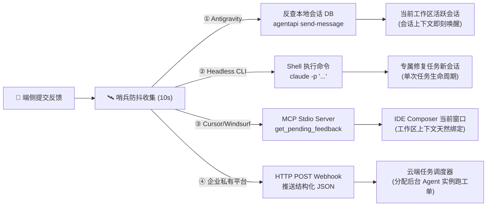

# Agent Feedback Bridge (@lylyuanliang/agent-feedback-*)

> **The In-App Nervous System & Live Loop for AI Coding Agents**<br>
> 面向 AI Coding Agent 时代的端侧神经系统、自愈闭环桥梁与可扩展开发者浮动工作台

[](LICENSE)
[](https://www.npmjs.com/package/@lylyuanliang/agent-feedback-vite-plugin)
[](#)
[](#)
[](#)

---

## 🌟 为什么需要 Agent Feedback Bridge？

在 AI Coding Agent（Antigravity、Cursor、Claude Code、Codex 等）时代，开发者与 AI 结对编程的痛点依然存在于**“运行时感知与真机还原”**：
- **现场还原成本高**：在手机真机、移动端 Web 或桌面端测试时发现 Bug，传统方式需要切出应用、手工截屏、打开 IDE 聊天框打字描述环境；
- **遥测数据碎片化**：现场报错堆栈、控制台异常、网络状态、DOM 快照与精确视口难以一并提供给 AI；
- **传统工具无法闭环**：传统 APM/反馈工具（Sentry、Marker.io）是将工单发给人（Jira/Slack），而我们需要的是**直接唤醒本地 IDE 中的 Coding Agent 自行分析并热修复**。

**Agent Feedback Bridge 提供的革命性自愈闭环**：
```
[真机/端侧一键点击] ──(截图+路由+报错全息打包)──> [本地 DevServer 日级分片队列]
                                                          │
                                                    (10s 防抖聚合)
                                                          │
                                                          ▼
[端侧时间轴实时同步修复进展] <──(CLI/状态回写)── [唤醒 IDE 中的 Coding Agent 自愈闭环]
```

---

## 🏆 四大核心优势 (Core Advantages)

不同于传统的简单反馈组件或单向文本日志收集器，**Agent Feedback Bridge** 是一套专为**人机结对开发、移动真机全息感知与本地 AI 闭环自愈**而生的全栈神经系统：

1. 📱 **移动真机全场景工程化 (Mobile-First Touch & Native Experience)**
   - **深度适配真实移动端**：专攻手机真机、原生容器（Capacitor / Cordova / React Native WebView）与移动 Web，绝非简陋的桌面网页工具；
   - **原生触控手势工程**：全贴边磁吸阻尼停靠、Pointer Events 级触控消抖（防误触误拖拽）、450ms 穿透门禁（彻底解决遮罩空白区伴随合成点击导致的误关闭）以及软键盘弹出防挤压与视口自适应。

2. 🛰️ **端侧全息遥测与高保真真实视觉 (Holographic Telemetry & Real-DOM Capture)**
   - **0 沟通成本现场装配**：一键自动捕获屏幕 DPR、真实视口尺寸、操作系统平台架构、页面 Hash 路由、以及最近 30 条 Console 报错与警告栈；
   - **高保真轻量真实截屏**：采用 `html2canvas` 自动捕获当前界面的真实全屏视觉画面，智能 Canvas 压缩算法将原图压缩 99% 至 ~80KB 轻量高保真 JPEG，秒级通过局域网/穿透网络上传；同时支持手机相册上传最多 6 张实景照片，并提供全屏手势 Lightbox 大图预览。

3. 🔄 **真正的端到端双向自愈闭环 (Bi-directional Self-Healing Neural Loop)**
   - **打破“只报不修”的死胡同**：端侧手机提交 -> DevServer 日级分片落盘 -> 静默哨兵（0% CPU，0 Token 消耗）守候并开启 10 秒防抖聚合 -> 主动唤醒 IDE 本地 Coding Agent -> Agent 源码级诊断、精准修复并通过自动化测试 -> CLI 状态回写；
   - **端侧无感进度复验**：端侧「历史与进度」时间轴内置 5 秒轻量自动轮询，工单修复后秒级变绿并直接展示 Agent 填写的详细自愈分析报告；支持 Agent / 流水线向端侧主动下发系统广播通知。

4. 🔌 **开放扩展槽架构 (Extension Tabs Workbench) 与 生产零残留 (Zero-DCE)**
   - **单一胶囊，无限扩展**：手机屏幕上仅需一个优雅悬浮胶囊，宿主应用通过 `registerExtensionTab` 规范即可无缝挂载专属业务能力（例如：内网穿透通信诊断、APK 流式断点续传在线更新、切屏保活等）；
   - **100% 生产零残留 (Zero-DCE)**：生产构建（`vite build`）全量物理剥离，构建产物增加 0 字节，0 调试接口泄露，完全不影响生产性能与安全。

---

## 🔄 端到端自愈工作闭环流程 (End-to-End Self-Healing Workflow)


---

## ⚡ 极速上手 (Quick Start)

仅需 **3 个简单步骤**，即可在任何 Vite 项目中跑通真机反馈与 Agent 自愈：

### 步骤 1：安装依赖
```bash
npm install -D @lylyuanliang/agent-feedback-vite-plugin @lylyuanliang/agent-feedback-client
# 或使用 pnpm
pnpm add -D @lylyuanliang/agent-feedback-vite-plugin @lylyuanliang/agent-feedback-client
```

### 步骤 2：在前端入口挂载悬浮球 (main.ts / main.js)
```typescript
import { initAgentFeedback } from '@lylyuanliang/agent-feedback-client';

// 开发期自动挂载真机反馈胶囊，生产构建会自动被 Zero-DCE 剔除
if (import.meta.env.DEV) {
  initAgentFeedback({ appName: '我的业务App' });
}
```

### 步骤 3：在 `vite.config.ts` 启用插件与哨兵
根据你当前使用的 Agent 类型，直接复制下一节对应的**开箱即用配方**！

---

## 🎯 各类型 Coding Agent 配置配方库 (Agent Recipes)

`agent-feedback` 是一套**与特定智能体完全解耦的开放网桥**。无论你使用的是哪种 Agent，都能按图索骥、1 行配置跑通闭环：

### 🟢 配方 A：Google Antigravity（0 配置原生伴生 · 推荐）
适合在 Google Antigravity IDE 2.0 中开发。哨兵原生随 DevServer 启动，通过本地工作区反向感知活跃会话，利用官方 `agentapi` 工具实现**毫秒级主动唤醒当前会话**。

```typescript
// vite.config.ts
import { defineConfig } from 'vite';
import { agentFeedback } from '@lylyuanliang/agent-feedback-vite-plugin';

export default defineConfig({
  plugins: [
    agentFeedback({
      storageDir: 'scratch/feedback',
      sentinel: {
        autoStart: true,         // 随 npm run dev 自动常驻守护，0心智负担
        debounceSeconds: 10      // 10秒防抖聚合窗口
        // adapter 默认自适应为 'antigravity'，无需额外配置
      }
    })
  ]
});
```

---

### 🟣 配方 B：Claude Code / Codex CLI / Aider（Headless CLI 自动拉起）
适合喜欢在终端使用 `claude`、`codex` 或 `aider` 命令行 Agent 的开发者。手机端反馈防抖收集完毕后，哨兵**自动在系统后台执行 CLI 命令唤醒 Agent 独立修复会话**。

```typescript
// vite.config.ts
import { defineConfig } from 'vite';
import { agentFeedback } from '@lylyuanliang/agent-feedback-vite-plugin';

export default defineConfig({
  plugins: [
    agentFeedback({
      storageDir: 'scratch/feedback',
      sentinel: {
        autoStart: true,
        debounceSeconds: 10,
        adapter: 'webhook',
        // 自动注入环境变量 $FEEDBACK_IDS 与 $FEEDBACK_COUNT
        webhookCommand: 'claude -p "端侧上报了最新移动端工单(ID: $FEEDBACK_IDS)，请检视 .agent/feedback 目录定位源码并修复，完成后调用 npx agent-feedback update-status 回写"'
      }
    })
  ]
});
```

---

### 🔵 配方 C：Cursor / Windsurf / VS Code (Cline/Roo Code)（标准 MCP 协议）
适合日常在 Cursor、Windsurf 或 VS Code 中与 AI Composer/Chat 结对的开发者。哨兵直接化身为标准的 Stdio MCP 工具服务。

#### 1. 配置 `vite.config.ts`：
```typescript
import { defineConfig } from 'vite';
import { agentFeedback } from '@lylyuanliang/agent-feedback-vite-plugin';

export default defineConfig({
  plugins: [
    agentFeedback({
      storageDir: 'scratch/feedback',
      sentinel: {
        autoStart: true,
        adapter: 'mcp' // 哨兵以 MCP 工具服务协议常驻
      }
    })
  ]
});
```

#### 2. 在项目根目录 `.cursor/mcp.json`（或 IDE 全局 MCP 配置）注册工具：
```json
{
  "mcpServers": {
    "agent-feedback": {
      "command": "npx",
      "args": ["-y", "@lylyuanliang/agent-feedback-sentinel", "mcp", "--dir", "scratch/feedback"]
    }
  }
}
```
*挂载后，Cursor/Windsurf 将自动获得 `get_pending_feedback` 与 `update_feedback_status` 两大工具，在聊天框中直接输入 `@agent-feedback 检查是否有手机端提交的新问题` 即可自主排查修复！*

---

### 🟠 配方 D：企业私有平台 / 钉钉飞书企微机器人（HTTP Webhook 派单）
适合团队拥有自建 AI 任务分配网关、自动化 CI/CD 平台或内部调度机器人的企业级场景。

```typescript
// vite.config.ts
import { defineConfig } from 'vite';
import { agentFeedback } from '@lylyuanliang/agent-feedback-vite-plugin';

export default defineConfig({
  plugins: [
    agentFeedback({
      storageDir: 'scratch/feedback',
      sentinel: {
        autoStart: true,
        debounceSeconds: 10,
        adapter: 'webhook',
        // 哨兵将包含机型、截屏、堆栈的标准 JSON 以 POST 请求推送到内部 Webhook 网关
        webhookUrl: 'https://ci.mycompany.com/api/v1/agent/feedback-webhook'
      }
    })
  ]
});
```

---

## 🧠 深度剖析：哨兵是如何找到并唤醒 Agent 会话的？ (Deep Dive)

许多开发者会有疑问：**“Agent 怎么知道哪个会话处理哪条反馈？是不是需要我们手动给出复杂的参数或者指示？”**

> **核心心智模型**：
> **不是 Agent 满地找会话，而是哨兵把工单精确送到了 Agent 嘴边！**
> 业务 Agent 根本不需要知道“底层会话是怎么路由的”，它只需要专注做它最擅长的事：**读工单、改代码、跑单测、回写状态**。

### 四大形态的会话确立原理：



1. **Google Antigravity 会话探测原理**：
   - 如果是在 IDE 内部启动，子进程拥有私有环境变量 `$env:ANTIGRAVITY_CONVERSATION_ID`，哨兵直接获取当前会话 ID；
   - 如果是在外部终端手动输入 `npm run dev`，哨兵内置 Node 原生 SQLite 查询引擎，只读读取 `~/.gemini/antigravity/conversation_summaries.db`，通过比对数据库中活跃会话绑定的工作区路径（`CWD Matching`），**反向精准查出当前项目对应的会话 ID**；
   - 哨兵通过官方底层 IPC 工具 `agentapi send-message <id>` 将高优先级消息直接注入该会话的上下文输入流中，实现如同微信收到高优消息般的毫秒级响应。
2. **Claude Code / Codex 命令行会话原理**：
   - 哨兵通过 `webhookCommand` 执行 `claude -p "..."`，拉起的每一个 CLI 进程本身就是一个针对该 Bugfix 任务的独立会话，任务完成后自动生成 commit 并交付。
3. **Cursor / Windsurf MCP 工具会话原理**：
   - 开发者是在当前 IDE 打开的工程上下文里与 Composer/Chat 对话，MCP 工具挂载在当前工作区，Agent 调用 `get_pending_feedback()` 拉取工单，工作区与工程上下文天然对应。
4. **企业自研平台 Webhook 会话原理**：
   - 包含截图与报错堆栈的标准 JSON 数据推送到企业的网关，企业的任务调度系统根据项目仓库分配一个无状态 Agent 容器或流水线任务执行自动修复。

---

## 🌐 真机联调与网络互通指南 (Mobile Device & Networking Guide)

Agent Feedback Bridge 的核心理念是让 AI Coding Agent 能够直接感知**移动端真机运行现场**。由于 AI Agent 运行在开发者的电脑 IDE 中，端侧（手机/平板/外部设备）必须能够访问到开发机的 DevServer 接口。

### 1. 多端测试网络拓扑矩阵

| 测试场景 | 端侧访问地址 | DevServer 网络配置 | `apiBase` 配置需求 |
| :--- | :--- | :--- | :--- |
| **A. 本地电脑桌面浏览器** | `http://localhost:5173` | 默认 `localhost` 即可 | **无需配置**（自动同源请求） |
| **B. 同一局域网 Wi-Fi 真机测试** | `http://192.168.x.x:5173` | 配置 `server: { host: true }` | **无需配置**（手机打开局域网网页，自动同源请求） |
| **C. 远程外网 / 4G / 5G 移动流量公测** | `https://xxxx.cpolar.top` | 使用 cpolar / ngrok 内网穿透 | **无需配置**（手机通过穿透域名访问网页，自动同源） |
| **D. 移动端混合原生 App (Capacitor/Cordova/Tauri)** | `capacitor://localhost` (离线内置包) | 开发机启动穿透或局域网服务 | **必须显式配置 `apiBase`**（指向开发机穿透地址） |

### 2. 外网穿透暴露服务 (以 cpolar / ngrok 为例)

当测试人员在室外走测，或手机使用移动蜂窝流量（4G/5G）不在同一 Wi-Fi 下时，可通过内网穿透工具将本机的 Vite DevServer 暴露至公网：

```bash
# 方式 1: 使用 cpolar (国内极速)
cpolar http 5173

# 方式 2: 使用 ngrok
ngrok http 5173

# 方式 3: 使用 Cloudflare Tunnel (免费免客户端)
cloudflared tunnel --url http://localhost:5173
```

### 3. 移动原生 App / 离线包指定 `apiBase`

在 Capacitor 等原生应用中，Webview 页面加载自本地离线资产目录（如 `capacitor://localhost`），此时可通过在 `vite.config.ts` 插件中配置远程开发机穿透地址：
```typescript
agentFeedback({
  storageDir: 'scratch/feedback',
  apiBase: 'https://7a3bxxxx.cpolar.top' // 声明远程开发机穿透地址
})
```

---

## 🔌 扩展槽功能指南 (Extension Tabs API)

`@lylyuanliang/agent-feedback-client` 提供了灵活的扩展槽机制，允许宿主应用在同一个悬浮胶囊中挂载专属的开发者功能页签（如环境切换、离线包更新、通信诊断等），使移动端调试体验高度聚合，无需在界面上摆放多个悬浮按钮。

### 注册自定义扩展 Tab 示例

```typescript
import { registerExtensionTab } from '@lylyuanliang/agent-feedback-client';
import { createApp } from 'vue'; // 支持 Vue / React / 原生 HTML
import MyCustomDebugPanel from './components/MyCustomDebugPanel.vue';

if (import.meta.env.DEV) {
  registerExtensionTab({
    id: 'my-custom-tools',            // 唯一 ID
    label: '🛠️ 联调与工具',             // Tab 显示文本 (支持 Emoji 或图标)
    render(container, context) {
      // 挂载 Vue 组件
      const app = createApp(MyCustomDebugPanel, {
        onClose: context.closeModal,
        onSwitchTab: context.openTab
      });
      app.mount(container);

      // 返回清理回调
      return () => {
        app.unmount();
      };
    }
  });
}
```

---

## 🛠️ CLI 命令行工具链

`@lylyuanliang/agent-feedback-sentinel` 提供了便捷的命令行能力：

```bash
# 1. 启动静默监听哨兵 (常驻守护模式)
npx agent-feedback watch --dir scratch/feedback --daemon

# 2. 向端侧时间轴主动插入一条 Agent 系统通知 (支持 CI/CD 或任务完成后自动调用)
npx agent-feedback notice "🎉 新版本已部署，修复了详情页图片偶发截断问题，请在手机端复验。" --dir scratch/feedback

# 3. 更新工单状态并写入自愈说明 (闭环通知端侧)
npx agent-feedback update-status <feedback-id> completed "经排查问题已修复并在当前版本生效，请在端侧下拉刷新验证。" --dir scratch/feedback
```

---

## 📦 Monorepo 子包生态矩阵

| 包名 | 最新版本 | 职责与能力 | 推荐安装命令 |
| :--- | :--- | :--- | :--- |
| [`@lylyuanliang/agent-feedback-vite-plugin`](packages/vite-plugin) | [](https://www.npmjs.com/package/@lylyuanliang/agent-feedback-vite-plugin) | **核心推荐**：Vite 构建插件、日级分片落盘引擎、DevServer 中间件与生产 Zero-DCE 剥离 | `npm install -D @lylyuanliang/agent-feedback-vite-plugin` |
| [`@lylyuanliang/agent-feedback-client`](packages/client) | [](https://www.npmjs.com/package/@lylyuanliang/agent-feedback-client) | `<agent-feedback-widget>` Web Component、手势工程、流式时间轴、多面板 KeepAlive 与扩展槽挂载器 | `npm install @lylyuanliang/agent-feedback-client` |
| [`@lylyuanliang/agent-feedback-sentinel`](packages/sentinel) | [](https://www.npmjs.com/package/@lylyuanliang/agent-feedback-sentinel) | Node 原生静默哨兵 CLI、10s 防抖聚合与多 IDE（Antigravity/Cursor/Claude Code）自愈适配器 | `npx agent-feedback watch` (免安装) |
| [`@lylyuanliang/agent-feedback-core`](packages/core) | [](https://www.npmjs.com/package/@lylyuanliang/agent-feedback-core) | 底层标准契约（TypeScript Types）、日级索引接口、扩展槽规范与启发式注入/破坏指令防御 | `npm install @lylyuanliang/agent-feedback-core` |

---

## 📱 完整参考项目 (Reference Implementation)

本项目已在开源户外拓扑应用 **《每周一山 · 成都周边50座山》** 中完成端到端全链路落地与实战检验：

- 🔗 **参考工程 GitHub 仓库**：[lylyuanliang/weekly-mountain](https://github.com/lylyuanliang/weekly-mountain)
- 🌿 **完整接入代码分支**：[`main`](https://github.com/lylyuanliang/weekly-mountain)

### 架构落地与最佳实践亮点
1. **职责正交解耦 (Clean Separation of Concerns)**：在宿主工程的 `vite.config.js` 中，业务构建逻辑与服务保持在独立插件中，而将所有的真机现场抓取、日级分片落盘与哨兵唤醒彻底委托给 `agentFeedback()` 插件，实现极高内聚与清晰解耦。
2. **统一开发者入口与扩展槽 (Unified Developer Hub via Extension Tabs)**：调用 `registerExtensionTab`，将内测在线更新、下载进度展示、WakeLock 切屏防中断以及局域网穿透诊断等能力无缝注入为同一个悬浮模态框的自定义 Tab，手机屏幕上只有一个悬浮胶囊即可纵览全部开发者能力。
3. **沉浸式主题系统融合 (Design System Integration)**：悬浮组件天然支持暗黑高山拓扑半透明玻璃拟物风，与宿主黑曜石高山设计系统融为一体。

---

## 📄 开源许可证

本项目采用 [MIT 许可证](LICENSE)。
