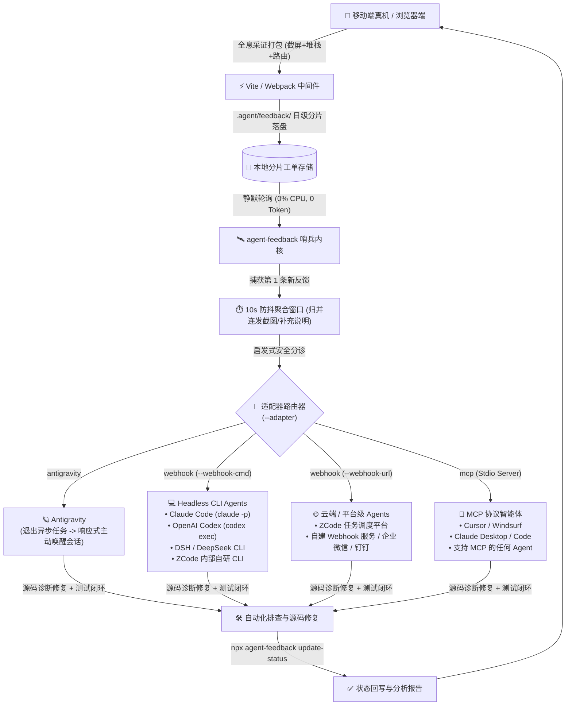

# 智能体生态接入与多 Agent 闭环指南 (Multi-Agent Integration Guide)

> **Agent Feedback Bridge** 是一套面向所有现代 AI Coding Agent 的开放式端侧神经系统。它**绝不仅限于某一款特定的 Agent**，而是通过解耦的「端侧全息采证 ➔ 本地分片存储 ➔ 静默防抖哨兵 ➔ 多模态唤醒适配器」流水线，全面支持市场上所有主流与自研智能体。

---

## 1. 架构总览：多 Agent 唤醒与分发拓扑

哨兵（Sentinel）内部包含**通用防抖收集内核**与**可插拔适配器（Pluggable Adapters）**：



---

## 2. Coding Agent 的准入要求与能力矩阵

任何 Agent 只要满足以下**能力层级**的任意一种，即可完美融入端到端自愈闭环：

| 能力层级 | Agent 需具备的核心特性 | 适用适配器模式 | 代表性 Agent |
| :--- | :--- | :--- | :--- |
| **L1: 响应式任务感知型** | 支持将后台子进程作为非 daemon 异步任务监听；子进程正常退出时系统产生事件主动唤醒 Agent 会话。 | `antigravity` | Google Antigravity |
| **L2: Headless CLI 调起型** | 支持通过终端命令传参启动（如 `-p "prompt"` 或 `exec "prompt"`），能读写本地文件与执行测试。 | `webhook` (`--webhook-cmd`) | Claude Code, Codex CLI, DSH, ZCode CLI |
| **L3: 标准工具协议型** | 原生支持 Model Context Protocol (MCP) 标准，能通过 Stdio 挂载工具并主动调用工具函数。 | `mcp` (Stdio MCP Server) | Claude Code, Cursor, Windsurf, Codex, Antigravity |
| **L4: 平台与网络 Webhook 型** | 拥有 HTTP 接收端点或任务调度网关，支持解析 JSON Payload 并分发异步修复任务。 | `webhook` (`--webhook-url`) | 企业内部自研 ZCode 平台、CI/CD 机器人 |

---

## 3. 各主流智能体具体实施方案

### 3.1 Google Antigravity 接入方案

Antigravity 拥有独特的非守护异步任务（Non-daemon background command）完成通知机制，是最具“0 资源消耗”特性的接入形态。

1. **项目协作规则配置**（写入项目内 `AGENTS.md` 或 `GEMINI.md`）：
   ```powershell
   # 启动监听（主会话中执行）
   npx agent-feedback watch --adapter antigravity
   ```
2. **闭环行为**：
   - 哨兵作为后台任务挂起；
   - 捕获真机反馈并完成 10 秒防抖后，哨兵自动执行 `process.exit(0)` 退出；
   - 退出事件直接触发 Antigravity 系统的 Reactive Wakeup，唤醒主会话进驻修复；
   - 修复完成后通过 `npx agent-feedback update-status <id> completed "修复报告"` 回写，并重新拉起新哨兵。

---

### 3.2 Claude Code (Anthropic CLI) 接入方案

Claude Code 支持两种极佳的接入模式：

#### 方案 A：Headless CLI 自动唤醒模式（推荐）
由哨兵监听并在捕获反馈后，通过 `--webhook-cmd` 直接拉起 Claude Code：

```bash
npx agent-feedback watch \
  --adapter webhook \
  --webhook-cmd "claude -p '端侧上报了最新移动端工单，请检查 .agent/feedback 目录下的最新反馈文件，分析堆栈与截屏后修复代码，并调用 npx agent-feedback update-status 完成状态回写'"
```

#### 方案 B：MCP 工具直接集成模式
Claude Code 原生支持 MCP，直接将哨兵注册为工具服务：
```bash
claude mcp add agent-feedback npx -y @lylyuanliang/agent-feedback-sentinel mcp
```
在 Claude 会话中，Claude 将自动获得两大工具：
- `get_pending_feedback`：拉取端侧新工单及截屏；
- `update_feedback_status`：修复完毕后更新进度与答复。

---

### 3.3 OpenAI Codex (Codex CLI) 接入方案

Codex CLI 支持通过终端管道或非交互式命令执行诊断。

#### 实施命令：
```bash
npx agent-feedback watch \
  --adapter webhook \
  --webhook-cmd "codex exec '检视 .agent/feedback/feedback_queue.json 中的端侧工单，结合当前代码库定位缺陷并修复，通过单元测试后使用 agent-feedback update-status 回写'"
```
环境变量自动注入：
哨兵在调起命令时会自动注入以下环境变量供脚本读取：
- `$env:FEEDBACK_COUNT`：本次批次聚合的反馈数量
- `$env:FEEDBACK_IDS`：本次批次的工单 ID 列表（逗号分隔）

---

### 3.4 DSH (DeepSeek / 自研终端 Shell Agent) 接入方案

对于基于 DeepSeek API 封装的终端自动化命令行工具（DSH）：

#### 实施命令：
```bash
npx agent-feedback watch \
  --adapter webhook \
  --webhook-cmd "dsh --auto-confirm -q '检测到手机端新问题上报(ID: %FEEDBACK_IDS%)，请读取 .agent/feedback 目录排查修复，执行 git diff 自测并通过 agent-feedback update-status 回写结果'"
```

---

### 3.5 ZCode (企业内部定制 / 平台级 AI Agent) 接入方案

针对企业内部私有化部署的 ZCode 智能体或团队任务分配中心，支持 **CLI 桥接** 与 **HTTP Webhook** 双通道：

#### 方案 A：企业内部 CLI 桥接
```bash
npx agent-feedback watch \
  --adapter webhook \
  --webhook-cmd "zcode task dispatch --project-path . --task-type bugfix --meta .agent/feedback/feedback_queue.json"
```

#### 方案 B：云端 / Webhook HTTP 自动派单
若 ZCode 拥有内部任务网关（例如内部自动化运维平台、钉钉/企微机器人）：
```bash
npx agent-feedback watch \
  --adapter webhook \
  --webhook-url "https://zcode.internal.company.com/api/v1/agent-feedback/webhook"
```
哨兵将以 `POST application/json` 发送标准结构化载荷：
```json
{
  "batch": [
    {
      "id": 1793259000123,
      "type": "issue",
      "status": "processing",
      "content": "切换 Tab 时界面有黑色闪烁",
      "timestamp": 1793259000123,
      "date": "2026-10-29",
      "telemetry": {
        "route": "/profile",
        "viewport": { "width": 393, "height": 852, "dpr": 3 },
        "platform": "Android",
        "userAgent": "Mozilla/5.0 ... Mobile"
      },
      "screenshot": "data:image/jpeg;base64,..."
    }
  ]
}
```

---

### 3.6 Cursor / Windsurf (IDE MCP 集成方案)

对于日常在 Cursor 或 Windsurf 中进行人机结对的开发者，可以通过 MCP 配置文件将哨兵工具直接挂载到 IDE 中。

在工程根目录创建或编辑 `.cursor/mcp.json`（或全局配置）：
```json
{
  "mcpServers": {
    "agent-feedback": {
      "command": "npx",
      "args": ["-y", "@lylyuanliang/agent-feedback-sentinel", "mcp", "--dir", ".agent/feedback"]
    }
  }
}
```
配置完成后：
- 开发者在 Cursor Composer 或 Agent 模式下直接键入：`@agent-feedback 检查是否有手机端提交的新问题`；
- Cursor 自动调用 `get_pending_feedback` 工具获取真机报错与视觉快照，分析后直接在编辑器中改写代码并回写状态。

---

## 4. Agent 自愈闭环的标准 SOP 流程 (Standard Operating Procedure)

为确保不同 Agent 接手任务时的稳定性与代码质量，建议将以下规范告知或写入 Agent 的系统提示词（System Prompt / Rules）：

```
[步骤 1: 侦测就绪]
  - 收到唤醒信号后，读取 .agent/feedback/ 最新工单或调用 get_pending_feedback()；
  - 提取 telemetry 中的视口尺寸、DPR、当前路由及 Console 报错堆栈；
  - 检视截屏与用户上传实景照片。

[步骤 2: 源码分析与精准修复]
  - 检索对应前端组件与状态管理逻辑；
  - 实施改动，严格遵循防御性编程，保持现有注释与代码排版；
  - 运行单元测试或自动化回归脚本验证改动有效性。

[步骤 3: 状态回写与闭环答复 (最关键门禁)]
  - 执行 CLI 命令回写状态并提供中文通俗答复：
    npx agent-feedback update-status <id> completed "【问题根因】... 【修复方案】... 【验证结果】..."
  - 移动端用户在手机端时间轴上立即收到变绿通知与答复。
```

---

## 5. 哨兵生命周期管理：如何摆脱 Prompt 限制实现真正全自动启停？

在日常开发与项目接入中，关于“哨兵需要反复启动吗？如何保证不漏掉？”的核心工程机制如下：

### 5.1 为什么当前在 Antigravity 中可以实现 100% 自动唤醒且无需重启？
在 Antigravity 中，哨兵直接对接其原生通信总线：`agentapi send-message $ANTIGRAVITY_CONVERSATION_ID "<message>"`。
因此：
1. 哨兵随 DevServer（`npm run dev`）启动后持续在后台常驻守护（`once: false`）；
2. 捕获反馈并防抖后，直接调用 `agentapi` 向当前会话发送高优先级原生消息，秒级唤醒 Agent；
3. 进程自身不退出，DevServer 不中断，**彻底解除以往需要 Agent 重新拉起哨兵的人工 Prompt 约束**。

### 5.2 第三方用户接入时，如何实现 100% 自动启停与无需重启？

对于使用其他 Agent 或追求纯工程级自动化的用户，有以下三大进阶方案：

#### 方案 A：持续守护监听模式（Continuous Daemon Loop · 无需任何重启）
**适用**：Claude Code、Codex CLI、DSH、ZCode、企业 Webhook。
在启动哨兵时声明 `--no-once`（或者代码配置 `once: false`）：
```bash
npx agent-feedback watch --no-once --adapter webhook --webhook-cmd "claude -p '...'"
```
- **工作机制**：
  1. 哨兵作为一个常驻守护进程常驻后台（0% CPU，2秒一次轻量轮询）；
  2. 捕获新反馈 ➔ 10s 防抖收集 ➔ 触发命令唤醒 Agent（如调起 `claude -p`）；
  3. **哨兵进程自身不退出，继续在后台监听下一轮**！
  4. Agent 完成修复并回写状态，整个流程哨兵一直在运行，**完全不需要任何 Prompt 约束，也不需要重新启动**。

#### 方案 B：与前端构建工具生命周期绑定（Vite 插件同生共死）
**适用**：所有使用 Vite / Webpack 的前端工程。
无需额外打开终端窗口运行哨兵，直接在 `vite.config.ts` 中配置托管：
```javascript
import { defineConfig } from 'vite';
import agentFeedback from '@lylyuanliang/agent-feedback-vite-plugin';

export default defineConfig({
  plugins: [
    agentFeedback({
      // 开发服务生命周期绑定：npm run dev 时自动托管哨兵；关闭服务时自动释放
      sentinel: {
        autoStart: true,
        adapter: 'antigravity' // 或 'webhook'
      }
    })
  ]
});
```
- 开发者只需敲击 `npm run dev`，哨兵自动伴随启动；
- 退出开发服务，哨兵自动释放，开发者 0 心智负担。

#### 方案 C：看门狗 Shell 包装器 (Watchdog Loop)
**适用**：任何必须依赖进程自杀退出产生事件通知的特定环境。
若担心 Agent 在完成交付时偶然遗忘重启命令，可用一个极其简易的看门狗脚本外层托管：
```powershell
# scripts/sentinel-watchdog.ps1
while ($true) {
    # 启动单次哨兵，收到反馈后 exit(0)
    npx agent-feedback watch --adapter antigravity
    # 此时已被唤醒，进入处理期；看门狗休眠 30 秒或轮询工单状态变为 processing/completed 后自动拉起新哨兵
    Start-Sleep -Seconds 30
}
```

---

## 6. 总结

`@lylyuanliang/agent-feedback` 提供了**端侧感知无缝连接任何 Coding Agent** 的全套基础设施：
- **需要 0 资源常驻？** ➔ 使用 Antigravity 原生退出唤醒机制；
- **使用现代开源 CLI？** ➔ 使用 Claude Code / Codex / DSH 的 `--webhook-cmd` 模式；
- **公司自研 Agent / 统一平台？** ➔ 使用 ZCode 的 `--webhook-url` 模式；
- **IDE 交互结对？** ➔ 使用标准 Stdio MCP 模式。

全生态互通，任意切换，无缝自愈！
