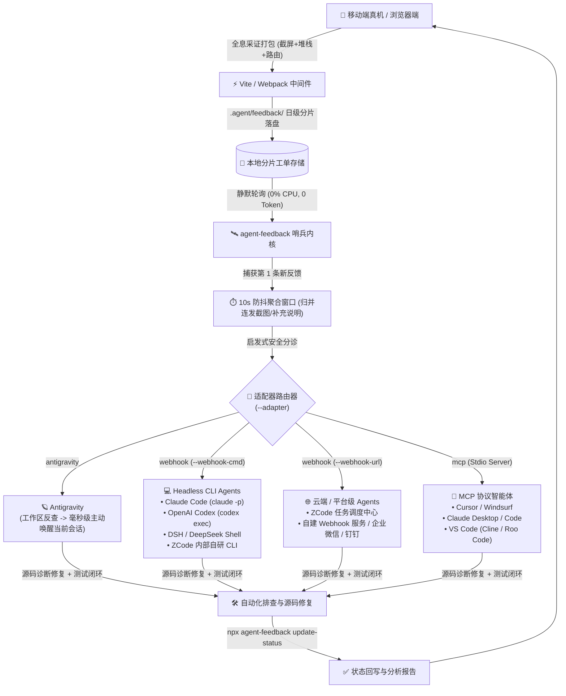
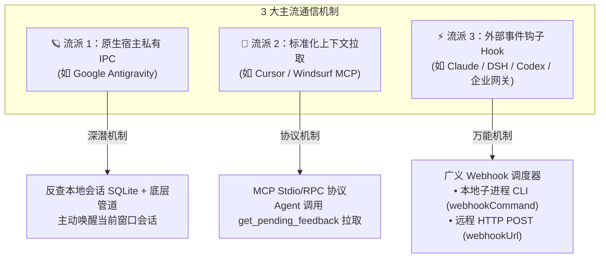

# 智能体生态接入与多 Agent 闭环指南 (Multi-Agent Integration Guide)

> **Agent Feedback Bridge** 是一套面向所有现代 AI Coding Agent 的开放式端侧神经系统。它**绝不仅限于某一款特定的 Agent**，而是通过解耦的「端侧全息采证 ➔ 本地分片存储 ➔ 静默防抖哨兵 ➔ 多模态唤醒适配器」流水线，全面支持市场上所有主流与自研智能体。

---

## 1. 架构总览：多 Agent 唤醒与分发拓扑

哨兵（Sentinel）内部包含**通用防抖收集内核**与**可插拔适配器（Pluggable Adapters）**：



---

## 2. 核心心智模型：Agent 怎么找到对应的会话？

许多开发者在接入其他 Agent 时会有最大的疑问：
> **“Agent 怎么知道哪个会话处理哪条反馈？是 Agent 自己去寻找会话，还是我们需要在提示词里给出复杂指令？”**

### 核心答案：
> **“不是 Agent 满地找会话，而是哨兵把工单精确送到了 Agent 嘴边！”**
> 业务 Agent 根本不需要知道“底层会话是怎么路由的”，它只需要专注做它最擅长的事：**读工单、改代码、跑单测、回写状态**。

### 各大形态的会话确立原理：

| 智能体形态 | 会话是如何定位与确立的？ | 开发者需要做什么？ |
| :--- | :--- | :--- |
| **Google Antigravity** | 哨兵反向查询本地 SQLite 数据库，通过比对活跃会话打开的工作区路径（`CWD Matching`）自动定位会话 ID，调用官方 `agentapi send-message <id>` 把高优工单塞入会话。 | **0 配置**。哨兵原生自动完成路由。 |
| **Claude Code / Codex** | 哨兵通过 `webhookCommand` 调用 Shell 命令拉起 `claude -p "..."`，拉起的命令行进程本身就是一个独立的修复任务会话，修改完代码后自动退出。 | 在 `vite.config.ts` 里配好命令即可。 |
| **DSH (DeepSeek Shell)** | 哨兵调用 `dsh --auto-confirm -q "..."`，自动创建基于 DeepSeek 模型的轻量 CLI 修复会话，自动定位并修复代码。 | 在 `vite.config.ts` 里配置 `dsh` 命令。 |
| **ZCode (企业内部平台)** | 哨兵通过 `zcode task dispatch` 命令行或 HTTP Webhook 推送，由企业内部调度系统自动分发到对应的项目专属修复实例。 | 配置 `zcode` 命令或指定内部 Webhook URL。 |
| **Cursor / Windsurf / VS Code** | 开发者是在当前 IDE 打开的项目工程上下文里与 Agent 对话，通过 MCP 协议挂载工具，Agent 在当前窗口调用 `get_pending_feedback()` 拉取，工作区上下文天然绑定。 | 在 `.cursor/mcp.json` 注册一次 MCP 服务。 |
| **通用企业 Webhook** | 哨兵将包含报错堆栈与截图的 JSON 数据 POST 到企业网关，企业的任务调度器根据仓库地址自动分配一个后台 Agent 实例去跑任务。 | 在 `vite.config.ts` 里填上 HTTP Webhook URL。 |

---

---

## 3. 架构深度思考：为什么大部分 Agent 适配器都是 Webhook？

在查阅配置配方时，许多开发者会产生一个直观的疑问：
> **“为什么除了 Google Antigravity 和 MCP 之外，像 Claude Code、DSH、Codex、ZCode、钉钉飞书等绝大多数 Agent，在配置里使用的都是 `adapter: 'webhook'`？”**

这背后并非巧合，而是源于 **AI 智能体的底层通信物理规律** 与 **框架的通用解耦哲学**。

### 3.1 行业物理规律：AI 智能体的底层通信本质只有「3 种形态」

抛开市场上五花八门的产品叫法（Claude Code、Cursor、DeepSeek DSH、Antigravity、OpenAI Codex、Cline 等），从操作系统进程与网络通信层来看，智能体与外部工具的交互机制在物理层面上只有 **3 种流派**：



| 通信机制流派 | 代表智能体 / 平台 | 底层物理协议 | 谁是主动方？ | 适用适配器类型 |
| :--- | :--- | :--- | :--- | :--- |
| **流派 1：原生宿主私有 IPC (Deep Native)** | **Google Antigravity** | 本地 SQLite 会话数据库反查 + 私有底层 IPC 管道 (`agentapi send-message`) | **哨兵主动**：直接把高优消息注入开发者当前正打开的 IDE 对话流中 | `adapter: 'antigravity'` |
| **流派 2：标准协议拉取 (Standard Pull)** | **Cursor、Windsurf、VS Code (Cline / Roo)** | Model Context Protocol (MCP) Stdio / JSON-RPC 协议 | **Agent 主动**：Agent 在当前 IDE 上下文内调用 `get_pending_feedback()` 工具拉取工单 | `adapter: 'mcp'` |
| **流派 3：事件钩子触发 (Event Hook)** | **Claude Code、DeepSeek DSH、OpenAI Codex、ZCode、企业调度中心** | **系统子进程创建 (`child_process.exec`) 或 HTTP POST 请求** | **哨兵主动**：在工单防抖聚合完成后，对外拉起新进程或推送结构化数据 | `adapter: 'webhook'` |

从上表可以看出：**除了 Antigravity（深度私有 API）与 Cursor（MCP 工具拉取）之外，市面上 80% 以上的智能体和平台，全部物理归属于「流派 3」！**

---

### 3.2 概念澄清：广义 Webhook vs 狭义 Webhook

许多开发者对 Webhook 的理解往往局限于**狭义 Webhook**：
> *通过 HTTP POST 向远程 Web 地址（如钉钉机器人、自建服务器）推送一段 JSON 数据。*

但在系统设计与事件驱动架构（EDA）中，**广义的 Webhook / Hook（钩子）** 代表的是一种**“事件发生后的外部触发机制”**：
> *“当手机端工单聚合完毕这个事件发生时，对外触发一个特定动作。”*

这个对外触发的动作在操作系统层面只有两种选择：
1. **触发本地命令行子进程（Command Hook）**：
   - 配置 `webhookCommand: 'claude -p "..."'` 或 `'dsh -q "..."'`；
   - 哨兵通过 Node.js 原生 `child_process.exec()` 拉起独立的 CLI Agent 进程，携带环境变量 `$FEEDBACK_DIR` 与 `$FEEDBACK_IDS` 前往工作区排查代码。
2. **触发远程网络端点（HTTP Webhook）**：
   - 配置 `webhookUrl: 'https://...'`；
   - 哨兵通过 HTTP POST 将包含截图和堆栈的标准 JSON 推送到企业网关或自动化集群。

为了避免让开发者在 `vite.config.ts` 中面对 `cli-adapter`、`command-adapter`、`shell-adapter`、`http-adapter` 等繁琐琐碎的细分概念，SDK 框架将这两种**“向外部派单触发”**的通用行为，统一收拢在 **`webhook`（外部钩子调度器）** 这一个总适配器下。

---

### 3.3 为什么 Webhook 是连接百家争鸣生态的“最大公约数”？

命令行（CLI）与网络请求（HTTP）是整个软件工程世界**最通用、最无技术壁垒的“通用普通话”**：
* 无论未来市场上涌现出多少种全新的终端 Agent 工具（如 X-Agent、Y-Code）；
* 无论你的企业是用 Python、Go 还是 Java 搭建的私有 AI 任务派单系统；
* **你完全不需要等待 `agent-feedback` 针对新工具发布专用适配器**，只需在 `webhookCommand` 或 `webhookUrl` 中填入一行命令或一个网址，就能在 1 分钟内完成接入闭环。

这就是为什么 Webhook 承担了连接绝大多数智能体的“万能通用胶水”角色。

---

## 4. 各主流智能体 vite.config.ts 完整配置配方库

> [!IMPORTANT]
> **⚠️ 核心对应关系：`storageDir` 与命令 Prompt 中的检索路径**
> 1. **强关联逻辑**：命令行 Agent 属于独立的外部进程，它完全依赖 Prompt 引号内的指令寻找工单数据。如果你在配置中指定了 `storageDir: 'scratch/feedback'`，Prompt 中就必须指引 Agent 读取 `scratch/feedback`；若写成了其他路径，Agent 检索对应目录将扑空。
> 2. **内置环境变量注入**：哨兵在调用 `webhookCommand` 时会自动向子进程注入以下环境变量：
>    - `$FEEDBACK_DIR`：当前配置的工单存储目录相对路径（如 `scratch/feedback` 或 `.agent/feedback`）；
>    - `$FEEDBACK_IDS`：本次捕获聚合的工单 ID 列表（逗号分隔）；
>    - `$FEEDBACK_COUNT`：本次批次包含的工单总数。
>    因此，你既可以直接书写匹配的目录路径，也可以直接在 Prompt 中引用 `$FEEDBACK_DIR` 实现与配置项的动态解耦！

### 4.1 Google Antigravity 接入配方
```typescript
// vite.config.ts
import { defineConfig } from 'vite';
import { agentFeedback } from '@lylyuanliang/agent-feedback-vite-plugin';

export default defineConfig({
  plugins: [
    agentFeedback({
      storageDir: 'scratch/feedback',
      sentinel: {
        autoStart: true,         // 随 npm run dev 自动常驻守护
        debounceSeconds: 10      // 10秒防抖聚合窗口
        // adapter 默认自适应为 'antigravity'
      }
    })
  ]
});
```
- **闭环效果**：真机一键提交，Antigravity IDE 聊天窗口立刻弹出 `📥 [Agent Feedback 自动唤醒]`，Agent 自动进驻修复。

---

### 4.2 Claude Code / OpenAI Codex 命令行接入配方
```typescript
// vite.config.ts
import { defineConfig } from 'vite';
import { agentFeedback } from '@lylyuanliang/agent-feedback-vite-plugin';

export default defineConfig({
  plugins: [
    agentFeedback({
      storageDir: 'scratch/feedback',
      sentinel: {
        autoStart: true,
        debounceSeconds: 10,
        adapter: 'webhook',
        // 环境变量 $FEEDBACK_IDS 会被自动替换为本次工单 ID
        webhookCommand: 'claude -p "端侧上报了最新移动端工单(ID: $FEEDBACK_IDS)，请检视 scratch/feedback 目录定位源码并修复，运行测试验证后通过 npx agent-feedback update-status 回写结果"'
      }
    })
  ]
});
```
- **闭环效果**：手机提交反馈后，哨兵防抖结束自动拉起后台 Claude Code 实例，全自动修复、单测回归并回写完成状态。

---

### 4.3 DSH (DeepSeek / 自研终端 Shell Agent) 接入配方
```typescript
// vite.config.ts
import { defineConfig } from 'vite';
import { agentFeedback } from '@lylyuanliang/agent-feedback-vite-plugin';

export default defineConfig({
  plugins: [
    agentFeedback({
      storageDir: 'scratch/feedback',
      sentinel: {
        autoStart: true,
        debounceSeconds: 10,
        adapter: 'webhook',
        // 通过 DSH 自动执行缺陷定位并回写状态（检索路径与 storageDir 保持一致，亦可写 $FEEDBACK_DIR）
        webhookCommand: 'dsh --auto-confirm -q "检测到手机端新工单(ID: $FEEDBACK_IDS)，请读取 scratch/feedback 目录排查并修复源码，通过单测后调用 npx agent-feedback update-status 回写结果"'
      }
    })
  ]
});
```
- **闭环效果**：自动调起轻量终端 DSH 进程，结合 DeepSeek 深度代码推理模型自动修复代码并交付。

---

### 4.4 ZCode (企业内部定制 / 平台级 AI Agent) 接入配方
针对企业内部自研的私有化 ZCode 智能体平台，支持 **CLI 桥接** 与 **云端 Webhook** 双通道：

#### 模式 1：ZCode 本地命令行派单
```typescript
// vite.config.ts
import { defineConfig } from 'vite';
import { agentFeedback } from '@lylyuanliang/agent-feedback-vite-plugin';

export default defineConfig({
  plugins: [
    agentFeedback({
      storageDir: 'scratch/feedback',
      sentinel: {
        autoStart: true,
        debounceSeconds: 10,
        adapter: 'webhook',
        webhookCommand: 'zcode task dispatch --project-path . --task-type bugfix --meta scratch/feedback/feedback_queue.json'
      }
    })
  ]
});
```

#### 模式 2：ZCode 云端平台调度派单
```typescript
// vite.config.ts
import { defineConfig } from 'vite';
import { agentFeedback } from '@lylyuanliang/agent-feedback-vite-plugin';

export default defineConfig({
  plugins: [
    agentFeedback({
      storageDir: 'scratch/feedback',
      sentinel: {
        autoStart: true,
        debounceSeconds: 10,
        adapter: 'webhook',
        // 推送到企业内部集中式智能体任务网关
        webhookUrl: 'https://zcode.internal.company.com/api/v1/agent-feedback/webhook'
      }
    })
  ]
});
```

---

### 4.5 Cursor / Windsurf (MCP 标准工具接入配方)
#### 1. 编辑 `vite.config.ts`：
```typescript
import { defineConfig } from 'vite';
import { agentFeedback } from '@lylyuanliang/agent-feedback-vite-plugin';

export default defineConfig({
  plugins: [
    agentFeedback({
      storageDir: 'scratch/feedback',
      sentinel: {
        autoStart: true,
        adapter: 'mcp' // 以 MCP 工具服务模式启动
      }
    })
  ]
});
```

#### 2. 在项目根目录 `.cursor/mcp.json`（或 IDE 全局 MCP 设置）添加：
```json
{
  "mcpServers": {
    "agent-feedback": {
      "command": "npx",
      "args": ["-y", "@lylyuanliang/agent-feedback-sentinel", "mcp", "--dir", "scratch/feedback"]
    }
  }
}
```
- **闭环效果**：在 Cursor Composer 中输入：`@agent-feedback 检查是否有手机端提交的新问题`，Cursor 自动调用 `get_pending_feedback` 获取真实视觉截图与 Console 报错，自动改写代码！

---

### 4.6 通用企业私有云 / Webhook 平台接入配方
```typescript
// vite.config.ts
import { defineConfig } from 'vite';
import { agentFeedback } from '@lylyuanliang/agent-feedback-vite-plugin';

export default defineConfig({
  plugins: [
    agentFeedback({
      storageDir: 'scratch/feedback',
      sentinel: {
        autoStart: true,
        debounceSeconds: 10,
        adapter: 'webhook',
        webhookUrl: 'https://ci.mycompany.com/api/v1/agent-feedback/dispatch'
      }
    })
  ]
});
```
- **Payload 格式**：哨兵以 `POST application/json` 发送标准结构化载荷：
```json
{
  "batch": [
    {
      "id": 1793259000123,
      "type": "user_feedback",
      "status": "processing",
      "content": "海报预览图被截断，无法上下滑动",
      "timestamp": 1793259000123,
      "date": "2026-10-30",
      "telemetry": {
        "route": "/profile",
        "viewport": { "width": 369, "height": 821, "dpr": 3.25 },
        "platform": "android"
      },
      "screenshots": ["screenshots/1793259000123.jpg"]
    }
  ]
}
```

---

## 5. Agent 自愈闭环的标准规则 (建议写入项目 AGENTS.md / Cursor Rules)

为了让任何新接手的 Agent 都能严格规范地完成闭环，建议在项目规则文件中加入以下 3 步规范：

```markdown
# 移动端真机反馈自愈规范

1. **现场还原**：收到端侧反馈时，读取 `scratch/feedback/` 目录下对应的 JSON 文件与截屏，提取真实视口尺寸与 Console 报错；
2. **源码修复与测试**：检索对应前端组件与 Store 逻辑，防御性修复缺陷，并运行本地自动化测试验证；
3. **状态闭环回写**：测试通过后，必须执行 CLI 命令回写完成状态与用户答复：
   npx agent-feedback update-status --id <id> --status completed --reply "修复说明..." --dir scratch/feedback
```

通过这一套标准规范，任何外部开发人员、任何团队的任何 Agent，都能以极低的心智成本和最高的工程质量接入 Agent Feedback 自愈生态！

---

## 6. 进阶专题与延伸阅读

* 📦 **生产构建 100% 自动剥离与真机 Debug 包构建**：深入了解编译期常量折叠（AST Constant Folding）、死代码消除（Zero-DCE）以及如何为移动端/桌面端混合应用定制保留悬浮气泡的真机测试包，请参阅专题指南：➔ [**《生产环境 100% 自动剥离 (Zero-DCE) 与真机 Debug 变体构建原理指南》**](production-zero-dce-and-debug-builds.md)。
