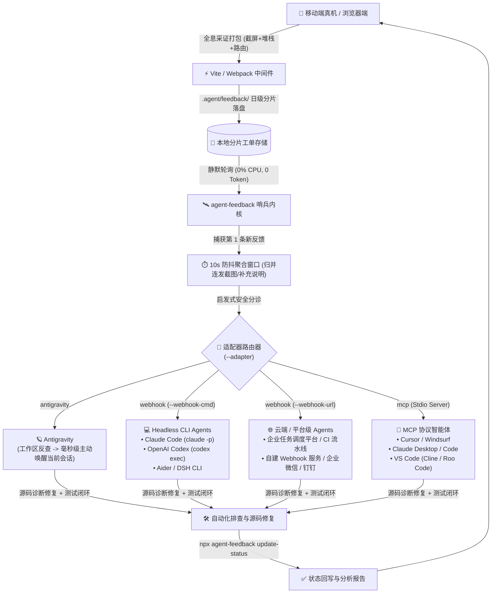

# 智能体生态接入与多 Agent 闭环指南 (Multi-Agent Integration Guide)

> **Agent Feedback Bridge** 是一套面向所有现代 AI Coding Agent 的开放式端侧神经系统。它**绝不仅限于某一款特定的 Agent**，而是通过解耦的「端侧全息采证 ➔ 本地分片存储 ➔ 静默防抖哨兵 ➔ 多模态唤醒适配器」流水线，全面支持市场上所有主流与自研智能体。

---

## 1. 架构总览：多 Agent 唤醒与分发拓扑

哨兵（Sentinel）内部包含**通用防抖收集内核**与**可插拔适配器（Pluggable Adapters）**：



---

## 2. 核心心智模型：Agent 怎么找到对应的会话？

许多开发者在接入其他 Agent 时会有最大的疑问：
> **“Agent 怎么知道哪个会话处理哪条反馈？是 Agent 自己去寻找会话，还是我们需要在提示词里给出复杂指令？”**

### 核心答案：
> **“不是 Agent 满地找会话，而是哨兵把工单精确送到了 Agent 嘴边！”**
> 业务 Agent 根本不需要知道“底层会话是怎么路由的”，它只需要专注做它最擅长的事：**读工单、改代码、跑单测、回写状态**。

### 四大形态的会话确立原理：

| 智能体形态 | 会话是如何定位与确立的？ | 开发者需要做什么？ |
| :--- | :--- | :--- |
| **Google Antigravity** | 哨兵反向查询本地 SQLite 数据库，通过比对活跃会话打开的工作区路径（`CWD Matching`）自动定位会话 ID，调用官方 `agentapi send-message <id>` 把高优工单塞入会话。 | **0 配置**。哨兵原生自动完成路由。 |
| **Claude Code / Codex / Aider** | 哨兵通过 `webhookCommand` 调用 Shell 命令拉起 `claude -p "..."`，拉起的命令行进程本身就是一个独立的修复任务会话，修改完代码后自动退出。 | 在 `vite.config.ts` 里配好命令即可。 |
| **Cursor / Windsurf / VS Code** | 开发者是在当前 IDE 打开的项目工程上下文里与 Agent 对话，通过 MCP 协议挂载工具，Agent 在当前窗口调用 `get_pending_feedback()` 拉取，工作区上下文天然绑定。 | 在 `.cursor/mcp.json` 注册一次 MCP 服务。 |
| **企业私有平台 / Webhook** | 哨兵将包含报错堆栈与截图的 JSON 数据 POST 到企业网关，企业的任务调度器根据仓库地址自动分配一个后台 Agent 实例去跑任务。 | 在 `vite.config.ts` 里填上 HTTP Webhook URL。 |

---

## 3. 各主流智能体 vite.config.ts 完整配置配方库

### 3.1 Google Antigravity 接入配方
```typescript
// vite.config.ts
import { defineConfig } from 'vite';
import { agentFeedback } from '@lylyuanliang/agent-feedback-vite-plugin';

export default defineConfig({
  plugins: [
    agentFeedback({
      storageDir: 'scratch/feedback',
      sentinel: {
        autoStart: true,         // 随 npm run dev 自动常驻守护
        debounceSeconds: 10      // 10秒防抖聚合窗口
        // adapter 默认自适应为 'antigravity'
      }
    })
  ]
});
```
- **闭环效果**：真机一键提交，Antigravity IDE 聊天窗口立刻弹出 `📥 [Agent Feedback 自动唤醒]`，Agent 自动进驻修复。

---

### 3.2 Claude Code 命令行接入配方
```typescript
// vite.config.ts
import { defineConfig } from 'vite';
import { agentFeedback } from '@lylyuanliang/agent-feedback-vite-plugin';

export default defineConfig({
  plugins: [
    agentFeedback({
      storageDir: 'scratch/feedback',
      sentinel: {
        autoStart: true,
        debounceSeconds: 10,
        adapter: 'webhook',
        // 环境变量 $FEEDBACK_IDS 会被自动替换为本次工单 ID
        webhookCommand: 'claude -p "端侧上报了最新移动端工单(ID: $FEEDBACK_IDS)，请检视 scratch/feedback 目录定位源码并修复，运行测试验证后通过 npx agent-feedback update-status 回写结果"'
      }
    })
  ]
});
```
- **闭环效果**：手机提交反馈后，哨兵防抖结束自动拉起后台 Claude Code 实例，全自动修复、单测回归并回写完成状态。

---

### 3.3 Cursor / Windsurf (MCP 标准工具接入配方)
#### 1. 编辑 `vite.config.ts`：
```typescript
import { defineConfig } from 'vite';
import { agentFeedback } from '@lylyuanliang/agent-feedback-vite-plugin';

export default defineConfig({
  plugins: [
    agentFeedback({
      storageDir: 'scratch/feedback',
      sentinel: {
        autoStart: true,
        adapter: 'mcp' // 以 MCP 工具服务模式启动
      }
    })
  ]
});
```

#### 2. 在项目根目录 `.cursor/mcp.json`（或 IDE 全局 MCP 设置）添加：
```json
{
  "mcpServers": {
    "agent-feedback": {
      "command": "npx",
      "args": ["-y", "@lylyuanliang/agent-feedback-sentinel", "mcp", "--dir", "scratch/feedback"]
    }
  }
}
```
- **闭环效果**：在 Cursor Composer 中输入：`@agent-feedback 检查是否有手机端提交的新问题`，Cursor 自动调用 `get_pending_feedback` 获取真实视觉截图与 Console 报错，自动改写代码！

---

### 3.4 企业私有云 / Webhook 平台接入配方
```typescript
// vite.config.ts
import { defineConfig } from 'vite';
import { agentFeedback } from '@lylyuanliang/agent-feedback-vite-plugin';

export default defineConfig({
  plugins: [
    agentFeedback({
      storageDir: 'scratch/feedback',
      sentinel: {
        autoStart: true,
        debounceSeconds: 10,
        adapter: 'webhook',
        webhookUrl: 'https://ci.mycompany.com/api/v1/agent-feedback/dispatch'
      }
    })
  ]
});
```
- **Payload 格式**：哨兵以 `POST application/json` 发送标准结构化载荷：
```json
{
  "batch": [
    {
      "id": 1793259000123,
      "type": "user_feedback",
      "status": "processing",
      "content": "海报预览图被截断，无法上下滑动",
      "timestamp": 1793259000123,
      "date": "2026-10-30",
      "telemetry": {
        "route": "/profile",
        "viewport": { "width": 369, "height": 821, "dpr": 3.25 },
        "platform": "android"
      },
      "screenshots": ["screenshots/1793259000123.jpg"]
    }
  ]
}
```

---

## 4. Agent 自愈闭环的标准规则 (建议写入项目 AGENTS.md / Cursor Rules)

为了让任何新接手的 Agent 都能严格规范地完成闭环，建议在项目规则文件中加入以下 3 步规范：

```markdown
# 移动端真机反馈自愈规范

1. **现场还原**：收到端侧反馈时，读取 `scratch/feedback/` 目录下对应的 JSON 文件与截屏，提取真实视口尺寸与 Console 报错；
2. **源码修复与测试**：检索对应前端组件与 Store 逻辑，防御性修复缺陷，并运行本地自动化测试验证；
3. **状态闭环回写**：测试通过后，必须执行 CLI 命令回写完成状态与用户答复：
   npx agent-feedback update-status --id <id> --status completed --reply "修复说明..." --dir scratch/feedback
```

通过这一套标准规范，任何外部开发人员、任何团队的任何 Agent，都能以极低的心智成本和最高的工程质量接入 Agent Feedback 自愈生态！
