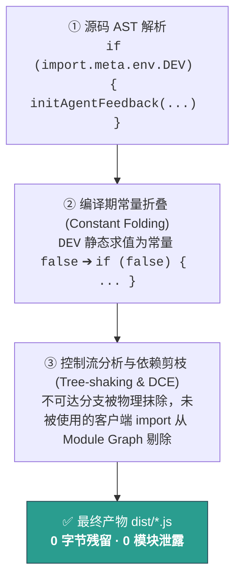
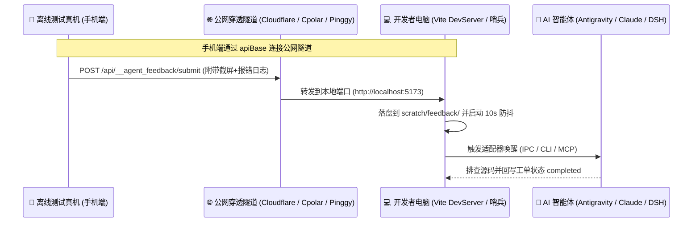

# 生产环境 100% 自动剥离 (Zero-DCE) 与真机 Debug 变体构建原理指南

> 本文档专为关注**生产包体积、安全审计**以及**跨端混合应用（Capacitor / Electron / 离线真机测试）**的架构师与开发人员编写。
> 深入阐明 Agent Feedback 在编译期的**死代码消除（Zero-DCE）物理机制**，以及如何在任何工程体系下根据底层原理灵活定制**真机 Debug / 测试包**。

---

## 1. 业务背景与两大核心诉求

在现代软件交付生命周期中，通常存在两种截然不同的诉求：

```
                    ┌────────────────────────┐
                    │     开发者的工程诉求     │
                    └───────────┬────────────┘
                                │
        ┌───────────────────────┴───────────────────────┐
        ▼                                               ▼
┌───────────────────────────────┐       ┌───────────────────────────────┐
│     诉求 A：纯 Web 生产发布    │       │   诉求 B：移动/桌面真机内测   │
│  (上线给普通真实用户的生产包)   │       │   (安装到手机/离线设备的测试包) │
├───────────────────────────────┤       ├───────────────────────────────┤
│ • 0 字节体积增加               │       │ • 必须保留反馈悬浮气泡        │
│ • 0 调试端点暴露               │       │ • 真机离线也能随时截屏提单     │
│ • 0 运行时代价与安全性无损     │       │ • 提交工单能够穿透直达开发电脑 │
└───────────────────────────────┘       └───────────────────────────────┘
```

---

## 2. 原理一：为什么默认生产构建能做到 100% 自动剥离 (Zero-DCE)？

很多开发者会有顾虑：
> *“我在代码里 `import { initAgentFeedback } from '@lylyuanliang/agent-feedback-client'`，生产打包时真的不会把几百 KB 的组件代码带到生产环境吗？”*

**答案：完全不会。** 这是通过 **Vite 插件原生生命周期隔离** 与 **打包器死代码消除（DCE）** 两道物理防线共同保障的。

### 防线 1：插件级生命周期物理隔离 (`apply: 'serve'`)
在 `@lylyuanliang/agent-feedback-vite-plugin` 源码中，声明了构建契约：
```typescript
export function agentFeedback(): Plugin {
  return {
    name: '@agent-feedback/vite-plugin',
    apply: 'serve', // 👈 关键契约：仅在开发模式 (vite dev / serve) 下激活
    // ...
  };
}
```
* **工作机制**：`apply: 'serve'` 是 Vite 标准插件体系的核心属性。当你执行生产打包（`vite build`）时，Vite 在加载插件的第一阶段就会**直接彻底无视并丢弃该插件**；
* **物理结果**：生产构建中**完全不存在**该插件注册的 Connect 中间件路由（`/api/__agent_feedback/*`）、后台哨兵监听进程以及 HTML 脚本注入逻辑。

### 防线 2：编译器 AST 常量替换与死代码消除 (Dead-Code Elimination)
在官方推荐的前端接入写法中：
```typescript
import { initAgentFeedback } from '@lylyuanliang/agent-feedback-client';

if (import.meta.env.DEV) {
  initAgentFeedback({ appName: '我的业务App' });
}
```
打包器（Rollup / Terser / ESBuild）在生产编译时会经历以下三步：



1. **常量折叠**：打包器将 `import.meta.env.DEV` 替换为静态布尔字面量 `false`；
2. **死代码检测**：控制流分析算法（Control Flow Analysis）判定 `if (false)` 块为**绝对不可达代码（Dead Code）**；
3. **依赖图修剪**：打包器遍历模块依赖图（Module Graph），发现模块 `@lylyuanliang/agent-feedback-client` 导出的所有函数在此产物中均无活跃引用，**直接将整个模块从输出 Chunk 中剔除**。

---

## 3. 原理二：如果要构建一个保留气泡的真机 Debug 包，核心本质是什么？

在 **移动混合 App（Capacitor / Cordova / React Native WebView）**、**桌面端（Electron / Tauri）** 或 **离线测试设备** 中：
* 手机上运行的是一个已经 `build` 完成的离线静态资源包；
* 如果完全按照上面的 `if (import.meta.env.DEV)`，打包出来的 APK 也会因为被识别为非开发模式而剥离气泡，导致测试人员在手机上无法提单。

### 🌟 唯一核心本质：
> **只要在打包编译期，让前端入口的挂载判断条件被静态求值为 `true`（而不是 `false`），就能阻止打包器的 DCE 算法把客户端代码抹除！**

只要理解了这一层编译原理，**你完全不需要拘泥于任何特定的打包命令或项目脚手架**，你可以根据你团队既有的 CI/CD 或打包体系，自由选择以下任何一种实现方式：

---

## 4. 业界常见的 3 种实现方式（供参考与触类旁通）

### 方案 A：自定义环境变量判断（最通用、轻量，推荐）
每个前端项目通常都有环境变量机制（如 Vite 的 `.env`、Webpack 的 `DefinePlugin`、Next.js 的 `process.env`）。

#### 1. 前端入口改造：
```typescript
// main.ts
import { initAgentFeedback } from '@lylyuanliang/agent-feedback-client';

// 原理：只要 isDebug 为 true，打包器就不会执行 DCE 剔除
const isDebug = import.meta.env.DEV || import.meta.env.VITE_ENABLE_DEBUG === 'true';

if (isDebug) {
  initAgentFeedback({
    appName: '我的App',
    // 💡 关键：脱离电脑局域网时，真机通过公网穿透地址提交工单给电脑哨兵
    apiBase: import.meta.env.VITE_FEEDBACK_API_BASE || undefined
  });
}
```

#### 2. 环境配置分型示例：
* **日常开发 / 内测测试环境（如 `.env` 或 `.env.staging`）**：
  ```properties
  VITE_ENABLE_DEBUG=true
  VITE_FEEDBACK_API_BASE=https://my-tunnel.cpolar.top
  ```
* **生产正式发布环境（如 `.env.production`）**：
  ```properties
  VITE_ENABLE_DEBUG=false
  VITE_FEEDBACK_API_BASE=
  ```

#### 3. 触发方式（依据团队习惯自行命名）：
```bash
# 示例 1：通过 Vite 的 mode 切换
vite build --mode staging     # 打出带悬浮球的内测包 (VITE_ENABLE_DEBUG=true)
vite build --mode production  # 打出纯净生产包 (VITE_ENABLE_DEBUG=false, 自动 100% 剥离)

# 示例 2：直接在命令行注入环境变量
cross-env VITE_ENABLE_DEBUG=true vite build
```

---

### 方案 B：动态 `import()` 按需加载（按功能特性打包）
如果希望彻底物理隔离，可以在特定路由或符合条件时动态加载模块：
```typescript
// App.vue 或 main.ts
onMounted(async () => {
  // 仅在明确开启测试的变体中异步下载/加载客户端
  if (import.meta.env.VITE_ENABLE_DEBUG === 'true') {
    try {
      const { initAgentFeedback } = await import('@lylyuanliang/agent-feedback-client');
      initAgentFeedback({ appName: '我的App' });
    } catch (e) {
      console.warn('Agent feedback client load skipped');
    }
  }
});
```
* **原理**：动态导入会由打包器切分为独立的异步 Chunk（如 `feedback-client.[hash].js`）。在正式生产打包且变量为 `false` 时，该代码分支被擦除，打包器甚至不会生成该 Chunk 文件。

---

### 方案 C：原生宿主注入（Android Flavor / iOS Scheme / Electron 模式）
在复杂大型原生 App 中，变体通常由原生编译系统（Gradle / Xcode）决定：
1. 原生层在构建时向 WebView 注入环境变量或全局配置：
   ```java
   // Android MainActivity.java (仅在 BuildConfig.DEBUG 为 true 时注入)
   if (BuildConfig.DEBUG) {
       webView.evaluateJavascript("window.__ENABLE_IN_APP_AGENT_FEEDBACK__ = true;", null);
   }
   ```
2. 前端根据原生注入的全局状态动态挂载：
   ```typescript
   if (window.__ENABLE_IN_APP_AGENT_FEEDBACK__) {
     import('@lylyuanliang/agent-feedback-client').then(({ initAgentFeedback }) => {
       initAgentFeedback({ appName: '我的原生混合App' });
     });
   }
   ```

---

## 5. 真机脱离电脑后的网络通信原理

真机测试人员往往带着手机在室外、测试区或会议室走动，手机与开发者的电脑通常不在同一个局域网。此时工单如何送达？



* **配置关键**：在 Debug 包初始化时传入 `apiBase`，指定公网穿透网关地址即可：
  ```typescript
  initAgentFeedback({
    appName: '我的App',
    apiBase: 'https://xxx.cpolar.top' // 或者是团队自建的反向代理地址
  });
  ```

---

## 6. 如何验证生产包确实达到了 100% 零残留？

作为严谨的研发工程师，你可以通过以下两步验证生产包的纯净度：

1. **执行生产构建**：
   运行项目既有的生产构建命令（如 `npm run build` 或 `vite build`）；
2. **在输出目录全局检索关键字**：
   在打包生成的静态目录（通常为 `dist/` 或 `build/`）中检索：
   ```bash
   # Windows PowerShell
   Get-ChildItem -Path dist -Recurse -Filter "*.js" | Select-String "@lylyuanliang/agent-feedback"

   # Linux / macOS
   grep -r "@lylyuanliang/agent-feedback" dist/
   ```
   **预期结果**：输出为空（0 匹配），证明所有代码与类库已全量被 Tree-shaking 消除，达成 100% Zero-DCE。
